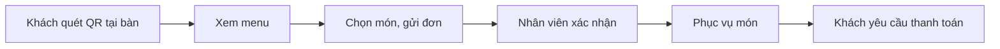

# Tổng quan nghiệp vụ — Menu QR Gọi món

> Mô tả demo này cho ai, giải quyết vấn đề gì. Cập nhật khi phạm vi thay đổi.

---

## 1. Thông tin chung

| Mục | Nội dung |
| :--- | :--- |
| Tên demo | Menu QR Gọi món |
| Mã dự án | `fnb-menu-qr` |
| Ngành / loại khách hàng | Nhà hàng, quán cafe, quán nhậu muốn khách tự gọi món |
| Loại sản phẩm | Web cho khách trên điện thoại + web quản lý |
| Ý tưởng gốc | 1.3 · Menu QR gọi món tại bàn (`ZDOCS/02-KE-HOACH/DANH-SACH-Y-TUONG.md`) |
| Người phụ trách | |
| Trạng thái | Mới tạo từ khuôn mẫu |

## 2. Vấn đề của khách hàng

- Giờ cao điểm thiếu người nhận order
- Menu giấy cũ, đổi giá phải in lại
- Khách chờ lâu mới gọi thêm món hoặc thanh toán được

## 3. Giải pháp demo thể hiện

- Mỗi bàn một mã QR, khách quét là thấy menu có ảnh, mô tả
- Khách tự chọn món, gửi đơn, gọi nhân viên, yêu cầu thanh toán
- Quán nhận đơn theo thời gian thực, xác nhận và phục vụ
- Quản lý menu, đánh dấu hết món, in QR theo bàn

## 4. Vai trò người dùng

| Vai trò | Mã | Dùng trên | Làm được gì |
| :--- | :--- | :--- | :--- |
| Khách | — | Điện thoại | Xem menu, gọi món (không cần đăng nhập) |
| Quản trị viên | ADMIN | Desktop | Toàn quyền |
| Quản lý | MANAGER | Desktop | Menu, bàn và QR, báo cáo |
| Nhân viên | STAFF | Tablet | Nhận đơn, xác nhận, phục vụ |

## 5. Phân hệ và chức năng

| Area | Chức năng | Màn hình (route FE dự kiến) | Ưu tiên |
| :--- | :--- | :--- | :---: |
| `System` | Đăng nhập, tài khoản, vai trò, cài đặt | Có sẵn | — |
| `Pos` | Menu cho khách qua QR | `/t/[tableCode]` | P1 |
| `Pos` | Giỏ món, gửi đơn | `/t/[tableCode]/cart` | P1 |
| `Pos` | Gọi nhân viên, yêu cầu thanh toán | `/t/[tableCode]` | P1 |
| `Pos` | Màn hình nhận đơn | `/orders/live` | P1 |
| `Pos` | Quản lý thực đơn, hết món | `/menu-items` | P1 |
| `Pos` | Quản lý bàn, in QR | `/tables` | P1 |
| `Pos` | Báo cáo đơn | `/reports` | P2 |

P1 = bắt buộc có để demo · P2 = nên có · P3 = làm thêm nếu còn thời gian.

## 6. Luồng nghiệp vụ chính

## 7. Phạm vi

**Có trong demo:**

- Giao diện khách trên điện thoại và màn hình nhận đơn của quán
- In QR theo bàn

**Không làm (nói rõ với khách nếu được hỏi):**

- Thanh toán online thật
- Tài khoản cho khách
- Các kết nối bên ngoài khác chỉ giả lập

## 8. Dữ liệu mẫu cần chuẩn bị

| Dữ liệu | Số lượng | Ghi chú |
| :--- | :---: | :--- |
| Bàn | 20 | Mỗi bàn một mã QR |
| Danh mục | 6 |  |
| Món | 50 | Có ảnh, mô tả |
| Đơn | ~2.000 | 90 ngày |
