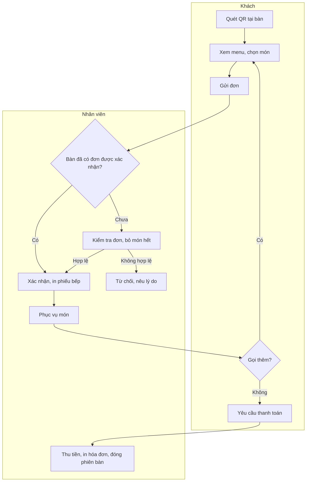
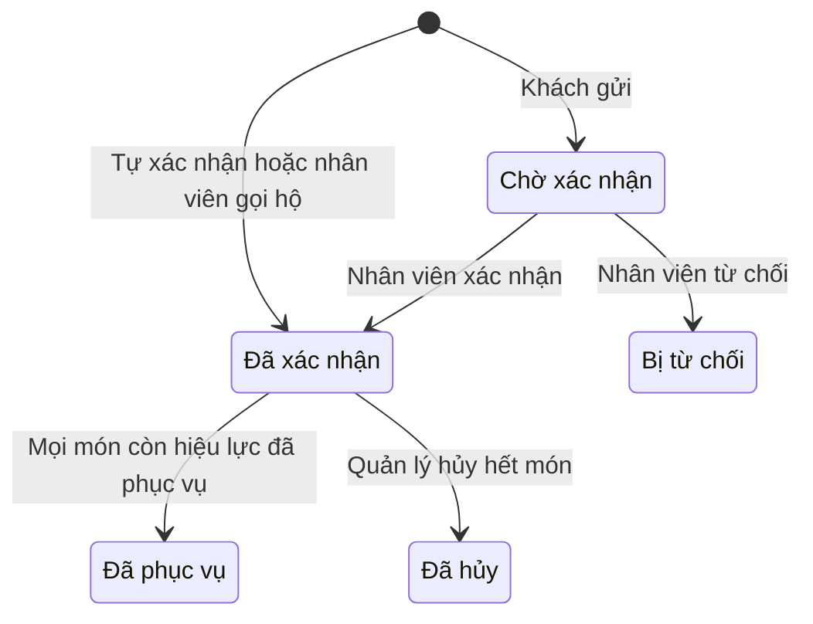
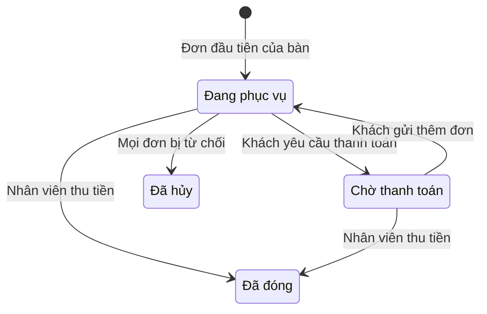

# Đặc tả yêu cầu phần mềm (SRS) — Menu QR Gọi món

| Phiên bản | Ngày | Trạng thái |
| :--- | :--- | :--- |
| 1.0 | 12/10/2026 | Bản nháp để triển khai demo |

> Cách viết, quy ước mã, mức độ chi tiết: `ZDOCS/05-HUONG-DAN/HUONG-DAN-VIET-TAI-LIEU-NGHIEP-VU.md`.
> Phần nền (đăng nhập, tài khoản, vai trò, cài đặt, đặt lại dữ liệu demo): `ZDOCS/03-KIEN-TRUC/USE-CASE-NEN.md`, không viết lại ở đây.

---

## 1. Giới thiệu

### 1.1. Mục đích

Tài liệu mô tả đầy đủ yêu cầu của bản demo Menu QR Gọi món: trang menu khách mở bằng điện thoại khi quét QR tại bàn, giỏ món, gửi đơn, gọi nhân viên, yêu cầu thanh toán; màn hình nhận đơn của quán; thực đơn có nhóm tùy chọn; quản lý bàn và in QR; quy tắc chống đặt bậy, dữ liệu, báo cáo, phân quyền và màn hình. Dev dùng để code, tester dùng để viết và chạy test case, sales dùng để biết demo làm được gì.

### 1.2. Phạm vi

**Trong phạm vi:** trang khách trên điện thoại (menu, chi tiết món, giỏ, gửi đơn, món đã gọi, gọi nhân viên, yêu cầu thanh toán, QR chuyển khoản giả lập), màn hình nhận đơn (xác nhận, bỏ món, từ chối, phục vụ, yêu cầu từ bàn, thu tiền và đóng phiên bàn), gọi món hộ khách (P2), thực đơn và nhóm tùy chọn, báo hết món, quản lý bàn, mã QR, in QR, cài đặt nhận đơn (P2), tổng quan và báo cáo (P2).

**Ngoài phạm vi:** thanh toán online thật và tự xác nhận tiền về (QR chỉ hiển thị, nhân viên tự xác nhận), tài khoản và tích điểm cho khách, kiểm tra vị trí khách (GPS, wifi của quán), màn hình bếp và máy in bếp thật (phiếu bếp in qua trình duyệt), khuyến mãi và voucher (đã có ở demo POS Quán Cafe), tách hóa đơn, phí phục vụ (đã có ở demo Quản lý Nhà hàng), hóa đơn điện tử, nhiều chi nhánh.

### 1.3. Thuật ngữ

| Thuật ngữ | Giải thích |
| :--- | :--- |
| Mã bàn | Chuỗi 6 ký tự ngẫu nhiên gắn với một bàn, nằm trong đường dẫn của mã QR |
| Trang khách | Trang menu khách mở bằng điện thoại sau khi quét QR, không cần cài app, không đăng nhập |
| Phiên bàn | Khoảng thời gian một nhóm khách ngồi tại bàn, từ đơn đầu tiên tới lúc thanh toán; gom mọi đơn của bàn trong thời gian đó |
| Đơn | Một lần gửi món từ một điện thoại, hoặc một lần nhân viên gọi món hộ |
| Nhóm tùy chọn | Bộ lựa chọn của món, vd Size, Thêm, Mức cay, Mức đá |
| Lựa chọn | Một mục trong nhóm tùy chọn, có thể có giá cộng thêm |
| Giỏ món | Món khách đã chọn nhưng chưa gửi, lưu trên điện thoại của khách |
| Tên gọi | Tên khách tự nhập khi gửi đơn để nhân viên dễ gọi, không bắt buộc |
| Xác nhận đơn | Nhân viên kiểm tra và chấp nhận đơn khách gửi trước khi làm món |
| Tự xác nhận | Đơn được chấp nhận ngay, không chờ nhân viên, khi bàn đã có đơn được xác nhận trong phiên |
| Bỏ món | Nhân viên loại một dòng khỏi đơn lúc xác nhận, kèm lý do |
| Từ chối đơn | Nhân viên không nhận cả đơn, kèm lý do |
| Yêu cầu từ bàn | Gọi nhân viên hoặc yêu cầu thanh toán do khách gửi từ điện thoại |
| Tạm tính | Tổng tiền các món đã xác nhận, chưa hủy của phiên bàn |
| Tạm ngưng nhận đơn | Quán tạm thời không nhận đơn qua QR; khách vẫn xem được menu |
| Màn hình nhận đơn | Trang của nhân viên hiển thị đơn mới, yêu cầu từ bàn và tình trạng bàn theo thời gian thực |
| Phiếu bếp | Bản in món của một đơn đã xác nhận, đưa cho bếp hoặc quầy pha chế |
| Doanh thu | Tổng tiền thu được của các phiên bàn đã đóng |

### 1.4. Tài liệu liên quan

| Tài liệu | Nội dung |
| :--- | :--- |
| `01-TONG-QUAN-NGHIEP-VU.md` | Tổng quan nghiệp vụ |
| `03-USE-CASE.md` | Đặc tả use case |
| `05-KICH-BAN-KIEM-THU.md` | Test case nghiệm thu |
| `ZDOCS/03-KIEN-TRUC/USE-CASE-NEN.md` | Phần nền dùng chung |

---

## 2. Mô tả tổng quan

### 2.1. Bối cảnh sản phẩm

Quán ăn, quán nhậu, quán cafe 15–40 bàn, giờ cao điểm 2–4 nhân viên chạy bàn không kịp nhận order. Mỗi bàn dán một tấm QR. Khách ngồi xuống, dùng camera điện thoại quét mã, xem menu có ảnh và tự gọi món; cả bàn có thể cùng gọi từ nhiều điện thoại. Nhân viên đứng ở quầy theo dõi màn hình nhận đơn trên tablet hoặc máy tính, xác nhận đơn, in phiếu cho bếp, mang món ra, thu tiền. Quản lý đổi giá, báo hết món, in QR và xem báo cáo trên máy tính. Bản demo chạy một quán.

### 2.2. Tác nhân

| Mã vai trò | Tên | Thiết bị | Mục tiêu khi dùng hệ thống |
| :--- | :--- | :--- | :--- |
| — | Khách | Điện thoại của khách | Xem menu rõ ràng, tự gọi món không phải chờ, gọi nhân viên và thanh toán nhanh |
| `ADMIN` | Quản trị viên | Desktop | Cấu hình hệ thống, tài khoản, phân quyền, thương hiệu hiển thị trên trang khách |
| `MANAGER` | Quản lý | Desktop | Thực đơn, giá, bàn và QR, cài đặt nhận đơn, hủy món, báo cáo |
| `STAFF` | Nhân viên | Tablet hoặc máy tính tại quầy | Nhận và xác nhận đơn kịp thời, phục vụ món, xử lý yêu cầu, thu tiền |

Tài khoản demo: `admin`, `quanly`, `nhanvien`. Khách không có tài khoản, vào trang khách bằng đường dẫn trong mã QR. Sau khi đăng nhập, Quản lý vào Tổng quan, Nhân viên vào Màn hình nhận đơn.

### 2.3. Quy trình nghiệp vụ

### 2.4. Giả định và ràng buộc

- Một quán, 20 bàn chia hai khu: Trong nhà (Bàn 01–12) và Ngoài sân (Bàn 13–20).
- Giá món và giá lựa chọn là bội số của 1.000 ₫, đã gồm thuế GTGT; không có phí phục vụ, không có giảm giá.
- Khách không có tài khoản. Giỏ món lưu trên trình duyệt điện thoại; mỗi điện thoại một giỏ riêng, mọi đơn gửi từ cùng bàn gom vào một phiên bàn.
- Không kiểm tra vị trí khách. Chống đặt bậy bằng xác nhận đơn đầu tiên của phiên, giới hạn số đơn chờ, đổi mã QR khi cần.
- Không có màn hình bếp. Xác nhận đơn mở bản in phiếu bếp khổ 80 mm qua trình duyệt (giả lập máy in bếp).
- QR chuyển khoản là ảnh giả lập theo định dạng VietQR; nhân viên tự xác nhận đã nhận tiền.
- Demo trên máy tính dùng chế độ thiết bị di động của trình duyệt (390×844) hoặc nút "Mở trang khách" (màn Bàn và QR, màn hình nhận đơn, trang đăng nhập, thanh công cụ demo). Ở chế độ dữ liệu mẫu, trang khách và màn hình nhận đơn mở ở các tab của cùng một trình duyệt; điện thoại thứ hai cùng bàn là một tab mở bằng "Thêm điện thoại cùng bàn".

---

## 3. Yêu cầu chức năng

### 3.1. Tổng quan

| Mã | Yêu cầu | Ưu tiên | Vai trò | UC |
| :--- | :--- | :---: | :--- | :--- |
| FR-01 | Hệ thống hiển thị số bàn đang mở phiên, số đơn chờ xác nhận, số yêu cầu chưa xử lý, doanh thu hôm nay, số phiên đã đóng, giá trị trung bình mỗi phiên, thời gian xác nhận đơn trung bình hôm nay | P2 | MANAGER | UC-14 |

### 3.2. Menu cho khách

| Mã | Yêu cầu | Ưu tiên | Vai trò | UC |
| :--- | :--- | :---: | :--- | :--- |
| FR-02 | Khách quét QR mở được menu của đúng bàn trên trình duyệt điện thoại, không cài app, không đăng nhập; đầu trang có logo, tên quán, tên bàn | P1 | Khách | UC-01 |
| FR-03 | Menu hiển thị thanh danh mục cuộn ngang dính đầu trang, món có ảnh, tên, giá, mô tả ngắn, nhãn (Bán chạy, Món mới, Cay, Chay); khách tìm món theo tên | P1 | Khách | UC-01 |
| FR-04 | Món hết hiển thị mờ với nhãn "Hết món", không thêm vào giỏ được | P1 | Khách | UC-01 |
| FR-05 | Khách chuyển ngôn ngữ menu Việt/Anh | P3 | Khách | UC-01 |

### 3.3. Giỏ món và gửi đơn

| Mã | Yêu cầu | Ưu tiên | Vai trò | UC |
| :--- | :--- | :---: | :--- | :--- |
| FR-06 | Khách chạm món để mở chi tiết: ảnh lớn, mô tả, các nhóm tùy chọn, ghi chú, số lượng, thành tiền tạm tính | P1 | Khách | UC-02 |
| FR-07 | Giỏ món lưu trên điện thoại theo bàn; khách sửa số lượng, sửa tùy chọn, xóa món; tổng tiền cập nhật ngay | P1 | Khách | UC-02 |
| FR-08 | Khách gửi đơn kèm tên gọi và ghi chú chung (không bắt buộc); điện thoại hiển thị mã đơn và trạng thái đơn ngay sau khi gửi | P1 | Khách | UC-02 |
| FR-09 | Hệ thống chặn gửi đơn ngoài giờ nhận đơn, khi quán tạm ngưng nhận đơn, khi bàn đang tắt hoặc vượt giới hạn chống gửi bậy, và nêu rõ lý do; khách vẫn xem được menu | P1 | Khách | UC-02 |
| FR-10 | Trang "Món đã gọi" hiển thị mọi đơn của phiên bàn hiện tại (gửi từ mọi điện thoại cùng bàn), trạng thái từng đơn và món, món bị bỏ kèm lý do, tạm tính | P1 | Khách | UC-03 |

### 3.4. Yêu cầu từ bàn

| Mã | Yêu cầu | Ưu tiên | Vai trò | UC |
| :--- | :--- | :---: | :--- | :--- |
| FR-11 | Khách bấm "Gọi nhân viên" và chọn nhanh lý do: Thêm đá, Lấy chén bát, Dọn bàn, Tư vấn món, Khác kèm ghi chú | P1 | Khách | UC-04 |
| FR-12 | Khách bấm "Yêu cầu thanh toán", chọn phương thức mong muốn (tiền mặt, chuyển khoản) và đánh dấu nếu cần xuất hóa đơn GTGT | P1 | Khách | UC-04 |
| FR-13 | Khách chọn chuyển khoản thì điện thoại hiển thị mã QR giả lập theo định dạng VietQR có số tiền bằng tạm tính và nội dung là mã phiên bàn | P2 | Khách | UC-04 |
| FR-14 | Màn hình nhận đơn có khu "Yêu cầu từ bàn" xếp theo thời gian gửi; nhân viên bấm "Đã xử lý"; trang khách hiển thị trạng thái yêu cầu | P1 | STAFF | UC-04 |

### 3.5. Nhận đơn và phục vụ

| Mã | Yêu cầu | Ưu tiên | Vai trò | UC |
| :--- | :--- | :---: | :--- | :--- |
| FR-15 | Màn hình nhận đơn hiển thị đơn mới theo thời gian thực, có âm báo và số đếm trên tiêu đề tab trình duyệt; thẻ đơn có bàn, giờ gửi, thời gian chờ, tên gọi, món, tùy chọn, ghi chú, tổng tiền | P1 | STAFF | UC-05 |
| FR-16 | Nhân viên xác nhận đơn; trước khi xác nhận được bỏ từng món kèm lý do (Hết món, Khác); kết quả hiện trên điện thoại khách | P1 | STAFF | UC-05 |
| FR-17 | Nhân viên từ chối cả đơn kèm lý do: Bàn không có khách, Đơn trùng, Hết món, Khác | P1 | STAFF | UC-05 |
| FR-18 | Xác nhận đơn (kể cả tự xác nhận) mở bản in phiếu bếp khổ 80 mm gồm bàn, mã đơn, giờ, món, tùy chọn, ghi chú (thay cho máy in bếp, giả lập) | P2 | STAFF | UC-05 |
| FR-19 | Nhân viên đánh dấu "Đã phục vụ" từng món hoặc cả đơn; đơn đã xác nhận chưa phục vụ xếp theo thời gian chờ | P1 | STAFF | UC-06 |
| FR-20 | Nhân viên gọi món hộ khách cho một bàn trên tablet; đơn do nhân viên tạo được xác nhận ngay | P2 | STAFF | UC-07 |
| FR-21 | Quản lý hủy món hoặc cả đơn đã xác nhận khi phiên chưa đóng, bắt buộc lý do; món hủy không tính tiền | P2 | MANAGER | UC-15 |

### 3.6. Phiên bàn và thanh toán

| Mã | Yêu cầu | Ưu tiên | Vai trò | UC |
| :--- | :--- | :---: | :--- | :--- |
| FR-22 | Màn hình nhận đơn có tab "Bàn" hiển thị mọi bàn với trạng thái (Trống, Đang phục vụ, Chờ thanh toán, Tắt); bàn có phiên hiển thị giờ mở, số đơn, tạm tính | P1 | STAFF | UC-08 |
| FR-23 | Nhân viên mở chi tiết phiên bàn, thu tiền mặt (hiện tiền thối) hoặc chuyển khoản (bấm "Đã nhận tiền"), in hóa đơn khổ 80 mm và đóng phiên | P1 | STAFF | UC-08 |
| FR-24 | Đóng phiên thì bàn về Trống; điện thoại khách đang mở trang bàn hiện lời cảm ơn và xóa giỏ; lần quét sau mở phiên mới | P1 | STAFF | UC-08 |
| FR-25 | Nhân viên chuyển phiên bàn sang bàn trống khác khi khách đổi chỗ | P3 | STAFF | UC-16 |

### 3.7. Thực đơn

| Mã | Yêu cầu | Ưu tiên | Vai trò | UC |
| :--- | :--- | :---: | :--- | :--- |
| FR-26 | Hệ thống cho phép quản lý thêm, sửa, ẩn, sắp xếp thứ tự danh mục | P1 | MANAGER | UC-09 |
| FR-27 | Hệ thống cho phép quản lý thêm, sửa, ẩn, sắp xếp món với mã, tên, danh mục, ảnh, mô tả, giá, nhãn, các nhóm tùy chọn áp dụng | P1 | MANAGER | UC-09 |
| FR-28 | Quản lý tạo nhóm tùy chọn dùng chung: tên, kiểu chọn một hoặc chọn nhiều, bắt buộc hay không, số lựa chọn tối đa, lựa chọn mặc định, giá cộng thêm của từng lựa chọn | P1 | MANAGER | UC-09 |
| FR-29 | Quản lý xem trước menu như khách thấy trong khung điện thoại ngay ở trang Thực đơn | P2 | MANAGER | UC-09 |
| FR-30 | Nhân viên và quản lý bật tắt "Hết món" cho món hoặc lựa chọn, chọn "Hết trong hôm nay" hoặc "Hết tới khi mở lại"; trang khách cập nhật trong 5 giây | P1 | STAFF, MANAGER | UC-10 |

### 3.8. Bàn và mã QR

| Mã | Yêu cầu | Ưu tiên | Vai trò | UC |
| :--- | :--- | :---: | :--- | :--- |
| FR-31 | Hệ thống cho phép quản lý thêm, sửa, bật tắt bàn với tên bàn, khu vực, sức chứa; hệ thống cấp mã bàn và đường dẫn QR riêng cho mỗi bàn; có nút "Mở trang khách" để thử | P1 | MANAGER | UC-11 |
| FR-32 | Quản lý đổi mã QR của bàn; mã cũ hết hiệu lực ngay | P2 | MANAGER | UC-11 |
| FR-33 | Quản lý in QR cho một hoặc nhiều bàn theo mẫu (thẻ dựng A6, tem dán 8×8 cm, tờ A4 4 mã), bản in có logo, tên quán, tên bàn, câu hướng dẫn; tải ảnh PNG từng mã | P1 | MANAGER | UC-12 |
| FR-34 | Quản lý cài đặt nhận đơn QR: giờ nhận đơn, chế độ xác nhận (thủ công mọi đơn, hoặc tự xác nhận khi bàn đã có đơn được xác nhận), tạm ngưng nhận đơn 15 phút, 30 phút hoặc tới khi mở lại | P2 | MANAGER | UC-13 |

### 3.9. Báo cáo

| Mã | Yêu cầu | Ưu tiên | Vai trò | UC |
| :--- | :--- | :---: | :--- | :--- |
| FR-35 | Báo cáo doanh thu theo ngày trong khoảng chọn: doanh thu, số phiên bàn, số đơn, giá trị trung bình mỗi phiên, so với kỳ liền trước cùng độ dài | P2 | MANAGER | UC-14 |
| FR-36 | Báo cáo món: số lượng gọi, doanh thu, tỉ trọng; món bị bỏ hoặc hủy nhiều nhất kèm lý do | P2 | MANAGER | UC-14 |
| FR-37 | Báo cáo vận hành: thời gian xác nhận đơn trung bình, thời gian xử lý yêu cầu trung bình, tỉ lệ đơn bị từ chối, tỉ lệ đơn khách tự gọi so với nhân viên gọi hộ, số đơn theo khung giờ | P2 | MANAGER | UC-14 |

---

## 4. Quy tắc nghiệp vụ

| Mã | Quy tắc | Áp dụng cho |
| :--- | :--- | :--- |
| BR-01 | Mã bàn gồm 6 ký tự lấy ngẫu nhiên từ A–Z và 2–9, bỏ O, I, L; duy nhất, không suy ra được từ tên bàn. Đường dẫn QR là `{tên miền}/t/{mã bàn}`. Đổi mã QR thì mã cũ hết hiệu lực ngay; mở mã cũ hoặc mã không tồn tại thì hiện "Mã QR không hợp lệ hoặc đã hết hiệu lực, vui lòng gọi nhân viên" | FR-02, FR-31, FR-32 |
| BR-02 | Phiên bàn mở khi đơn đầu tiên của bàn được gửi hoặc nhân viên gọi món hộ. Mỗi bàn tối đa một phiên đang mở; mọi đơn gửi từ bàn trong lúc phiên mở thuộc phiên đó. Mọi đơn của phiên đều bị từ chối thì phiên tự hủy, bàn về Trống | FR-08, FR-20, FR-22 |
| BR-03 | Thành tiền một dòng = (giá món + tổng giá cộng thêm của các lựa chọn) × số lượng. Số lượng mỗi dòng từ 1 đến 20. Giá đã gồm thuế GTGT | FR-06, FR-07 |
| BR-04 | Nhóm "chọn một" bắt buộc: phải chọn đúng 1, có lựa chọn mặc định thì chọn sẵn. Nhóm "chọn một" không bắt buộc: chọn 0 hoặc 1. Nhóm "chọn nhiều": chọn từ 0 tới số tối đa (1–10). Thiếu lựa chọn bắt buộc thì nút "Thêm vào giỏ" khóa, nhóm báo đỏ "Bắt buộc chọn 1"; chọn quá số tối đa thì không cho chọn thêm, báo "Chọn tối đa {n}" | FR-06, FR-28 |
| BR-05 | Giỏ món lưu trên trình duyệt theo mã bàn, giữ tối đa 4 giờ. Thêm món giống hệt dòng đã có (cùng lựa chọn, cùng ghi chú) thì cộng số lượng. Khi gửi, hệ thống tính lại theo thực đơn hiện hành: dòng có món hoặc lựa chọn đã hết bị chặn và báo đỏ; giá đã đổi thì báo "Giá đã thay đổi", cập nhật giỏ và chờ khách bấm gửi lại | FR-07, FR-08, FR-30 |
| BR-06 | Chống gửi bậy: mỗi đơn tối đa 30 dòng; mỗi bàn tối đa 3 đơn "Chờ xác nhận" cùng lúc; cùng một giỏ gửi lại trong 10 giây không tạo đơn mới | FR-09 |
| BR-07 | Chỉ nhận đơn trong giờ nhận đơn (mặc định 09:00–22:00), khi quán không tạm ngưng nhận đơn và bàn đang bật. Hết thời gian tạm ngưng thì tự nhận đơn lại | FR-09, FR-34 |
| BR-08 | Chế độ "Thủ công": mọi đơn khách gửi ở "Chờ xác nhận". Chế độ "Tự xác nhận khi bàn đã có đơn được xác nhận" (mặc định): đơn gửi khi phiên đã có ít nhất một đơn "Đã xác nhận" hoặc "Đã phục vụ" chuyển ngay "Đã xác nhận", các đơn còn lại chờ nhân viên. Đơn nhân viên gọi hộ luôn "Đã xác nhận" | FR-16, FR-20, FR-34 |
| BR-09 | Trạng thái đơn: Chờ xác nhận → Đã xác nhận → Đã phục vụ (khi mọi món còn hiệu lực đã phục vụ); Chờ xác nhận → Bị từ chối; Đã xác nhận → Đã hủy (khi quản lý hủy hết món). Đơn chờ xác nhận từ 5 phút: thẻ vàng; từ 10 phút: thẻ đỏ, xếp đầu danh sách; đơn không tự hủy | FR-15, FR-16, FR-17, FR-19 |
| BR-10 | Bỏ món khi xác nhận: đơn phải còn ít nhất một món, bỏ hết thì dùng "Từ chối". Món bị bỏ không tính tiền; khách thấy "Không phục vụ được: {lý do}". Bỏ món với lý do "Hết món" thì món đó tự chuyển "Hết trong hôm nay" | FR-16 |
| BR-11 | Tạm tính phiên = tổng thành tiền các món thuộc đơn "Đã xác nhận" hoặc "Đã phục vụ", trừ món bị bỏ và món đã hủy. Đơn "Chờ xác nhận", "Bị từ chối" không tính | FR-10, FR-22, FR-23 |
| BR-12 | Yêu cầu từ bàn: "Gọi nhân viên" gửi lại trong 60 giây không tạo yêu cầu mới; mỗi phiên chỉ có một "Yêu cầu thanh toán" đang chờ, và chỉ gửi được khi tạm tính lớn hơn 0. Yêu cầu chờ từ 3 phút chuyển đỏ. Khách gửi thêm đơn khi đang có yêu cầu thanh toán thì yêu cầu đó tự hủy, phiên về "Đang phục vụ" | FR-11, FR-12, FR-14 |
| BR-13 | Đóng phiên: không đóng được khi còn đơn "Chờ xác nhận"; còn món đã xác nhận chưa phục vụ thì cảnh báo, nhân viên xác nhận vẫn đóng được. Tiền mặt: tiền khách đưa phải lớn hơn hoặc bằng tạm tính, tiền thối = tiền khách đưa − tạm tính. Chuyển khoản: số tiền bằng tạm tính. Đóng phiên thì mọi yêu cầu đang chờ của bàn tự chuyển "Đã xử lý" | FR-23, FR-24 |
| BR-14 | "Hết trong hôm nay" tự mở bán lại lúc 00:00; "Hết tới khi mở lại" giữ nguyên tới khi có người bật lại. Lựa chọn hết thì không chọn được; nhóm bắt buộc mà mọi lựa chọn đều hết thì món hiển thị "Hết món" | FR-04, FR-30 |
| BR-15 | Hủy món đã xác nhận: chỉ quản lý, bắt buộc lý do, chỉ khi phiên chưa đóng. Món hủy không tính tiền; lưu người hủy, lý do, thời điểm | FR-21 |
| BR-16 | Món đã từng được gọi không xóa được, chỉ ẩn. Dòng đơn lưu tên, giá món, tên và giá lựa chọn tại thời điểm gửi. Giá món là bội số 1.000 ₫ và lớn hơn 0; giá cộng thêm của lựa chọn là bội số 1.000 ₫, từ 0 | FR-27, FR-28 |
| BR-17 | Tên bàn không trùng; sức chứa từ 1 đến 20. Bàn đang có phiên mở không tắt, không xóa được. Bàn tắt: khách quét vẫn xem menu nhưng không gửi đơn được, trang hiện "Bàn tạm ngưng nhận đơn qua QR, vui lòng gọi nhân viên" | FR-09, FR-31 |
| BR-18 | Chuyển bàn (P3): chỉ sang bàn Trống và đang bật; phiên giữ nguyên mã; điện thoại đang mở trang bàn cũ hiện "Bàn của quý khách đã chuyển sang {bàn mới}, vui lòng quét QR bàn mới" | FR-25 |
| BR-19 | Doanh thu = tổng tiền thu của phiên đã đóng, tính theo thời điểm đóng; phiên hủy không tính. Giá trị trung bình phiên = doanh thu ÷ số phiên đã đóng. Thời gian xác nhận = giờ xác nhận hoặc từ chối − giờ gửi, chỉ tính đơn khách gửi phải chờ nhân viên. Thời gian xử lý yêu cầu = giờ xử lý − giờ gửi, không tính yêu cầu tự xử lý khi đóng phiên. Tỉ lệ từ chối = số đơn bị từ chối ÷ số đơn khách gửi | FR-01, FR-35, FR-37 |
| BR-20 | Mã đơn `DH` + `yyMMdd` + 4 số thứ tự trong ngày. Mã phiên bàn `PB` + `yyMMdd` + 4 số, in trên hóa đơn và dùng làm nội dung chuyển khoản | FR-08, FR-13, FR-23 |

---

## 5. Yêu cầu dữ liệu

### 5.1. Thực thể

| Thực thể | Mô tả | Thuộc tính chính | Quan hệ |
| :--- | :--- | :--- | :--- |
| Bàn | Bàn có mã QR | Tên bàn, khu vực, sức chứa, mã bàn, thời điểm đổi mã gần nhất, đang bật | Có nhiều phiên bàn, nhiều yêu cầu |
| Danh mục | Nhóm món trên trang khách | Tên, tên tiếng Anh (P3), thứ tự, hiển thị | Có nhiều món |
| Món | Món ăn, đồ uống bán ra | Mã, tên, tên tiếng Anh (P3), ảnh, mô tả, giá, nhãn, thứ tự, trạng thái (đang bán, hết món, ẩn), kiểu hết (trong hôm nay, tới khi mở lại) | Thuộc một danh mục; gắn nhiều nhóm tùy chọn |
| Nhóm tùy chọn | Bộ lựa chọn dùng chung | Tên, kiểu chọn (một, nhiều), bắt buộc, số chọn tối đa | Có nhiều lựa chọn; gắn với nhiều món |
| Lựa chọn | Một mục trong nhóm | Tên, giá cộng thêm, mặc định, trạng thái hết | Thuộc một nhóm tùy chọn |
| Phiên bàn | Lượt khách ngồi tại bàn | Mã, giờ mở, giờ đóng, tạm tính, phương thức thanh toán, tiền khách đưa, tiền thối, cần hóa đơn GTGT, người đóng, trạng thái | Thuộc một bàn; có nhiều đơn, nhiều yêu cầu |
| Đơn | Một lần gửi món | Mã, nguồn (khách QR, nhân viên), tên gọi, ghi chú, giờ gửi, giờ xác nhận, người xác nhận, tự xác nhận, trạng thái, lý do từ chối, tổng tiền, mã thiết bị ẩn danh | Thuộc một phiên bàn; có nhiều dòng đơn |
| Dòng đơn | Một món trong đơn | Tên món, giá món, các lựa chọn kèm giá, ghi chú, số lượng, thành tiền, trạng thái (chờ xác nhận, đã xác nhận, bị bỏ, đã phục vụ, đã hủy), lý do bỏ hoặc hủy, người hủy, giờ phục vụ | Thuộc một đơn; tham chiếu một món |
| Yêu cầu từ bàn | Gọi nhân viên, yêu cầu thanh toán | Loại, lý do, ghi chú, phương thức mong muốn, cần hóa đơn GTGT, giờ gửi, giờ xử lý, người xử lý, trạng thái | Thuộc một bàn; gắn phiên bàn nếu có |
| Cài đặt nhận đơn | Tham số nhận đơn QR | Giờ bắt đầu, giờ kết thúc, chế độ xác nhận, tạm ngưng tới | Dùng chung |

Mã thiết bị ẩn danh là chuỗi ngẫu nhiên lưu trên trình duyệt điện thoại, chỉ dùng để chống gửi trùng và gom đơn của cùng một điện thoại, không phải thông tin cá nhân.

### 5.2. Vòng đời

**Đơn**

**Phiên bàn**

**Dòng đơn:** Chờ xác nhận → Đã xác nhận → Đã phục vụ; Chờ xác nhận → Bị bỏ (nhân viên bỏ khi xác nhận); Đã xác nhận hoặc Đã phục vụ → Đã hủy (quản lý hủy).

**Yêu cầu từ bàn:** Đang chờ → Đã xử lý (nhân viên bấm, hoặc tự động khi đóng phiên); Yêu cầu thanh toán đang chờ → Đã hủy khi khách gửi thêm đơn.

**Bàn:** Trống ↔ Đang phục vụ ↔ Chờ thanh toán theo phiên bàn; Bật ↔ Tắt do quản lý chuyển khi bàn không có phiên.

### 5.3. Mã chứng từ

| Chứng từ | Định dạng | Ví dụ |
| :--- | :--- | :--- |
| Mã bàn (trong QR) | 6 ký tự A–Z, 2–9, bỏ O, I, L | `K7M2QX` |
| Đường dẫn QR | `{tên miền}/t/{mã bàn}` | `…/t/K7M2QX` |
| Đơn | `DH` + `yyMMdd` + 4 số | `DH2610120087` |
| Phiên bàn (số hóa đơn) | `PB` + `yyMMdd` + 4 số | `PB2610120031` |
| Món | `M` + 3 số | `M024` |

---

## 6. Báo cáo

| Báo cáo | Chỉ số | Bộ lọc | Vai trò |
| :--- | :--- | :--- | :--- |
| Tổng quan hôm nay | Bàn đang mở phiên, đơn chờ xác nhận, yêu cầu chưa xử lý, doanh thu, số phiên đã đóng, giá trị trung bình phiên, thời gian xác nhận trung bình | — | MANAGER |
| Doanh thu theo ngày | Doanh thu, số phiên bàn, số đơn, giá trị trung bình phiên, so kỳ trước | Khoảng ngày | MANAGER |
| Món | Số lượng gọi, doanh thu, tỉ trọng; món bị bỏ, bị hủy và lý do | Khoảng ngày, danh mục | MANAGER |
| Vận hành | Thời gian xác nhận trung bình, thời gian xử lý yêu cầu trung bình, tỉ lệ đơn bị từ chối, tỉ lệ đơn tự xác nhận, tỉ lệ đơn khách tự gọi so với nhân viên gọi hộ, bảng nhiệt số đơn theo giờ và thứ | Khoảng ngày | MANAGER |

---

## 7. Phân quyền

> Quyền nền (`dashboard`, `users`, `roles`, `settings`, `audit-logs`) xem `USE-CASE-NEN.md` §7. Trang khách `/t/*` công khai, không cần quyền; API cho khách chỉ nhận mã bàn hợp lệ (BR-01) và chỉ trả dữ liệu của phiên bàn đó.

| Mã quyền | Mô tả | ADMIN | MANAGER | STAFF |
| :--- | :--- | :---: | :---: | :---: |
| `menu-items.view` | Xem thực đơn | ✓ | ✓ | ✓ |
| `menu-items.create` / `update` / `delete` | Quản lý danh mục, món, nhóm tùy chọn | ✓ | ✓ | |
| `menu-items.availability` | Báo hết món, bán lại | ✓ | ✓ | ✓ |
| `tables.view` | Xem trang Bàn và QR | ✓ | ✓ | |
| `tables.create` / `update` / `delete` | Thêm, sửa, bật tắt bàn, đổi mã QR | ✓ | ✓ | |
| `tables.print-qr` | In, tải mã QR | ✓ | ✓ | |
| `order-settings.update` | Giờ nhận đơn, chế độ xác nhận, tạm ngưng nhận đơn | ✓ | ✓ | |
| `orders.view` | Xem màn hình nhận đơn | ✓ | ✓ | ✓ |
| `orders.confirm` | Xác nhận, bỏ món, từ chối đơn | ✓ | ✓ | ✓ |
| `orders.serve` | Đánh dấu đã phục vụ | ✓ | ✓ | ✓ |
| `orders.create` | Gọi món hộ khách | ✓ | ✓ | ✓ |
| `orders.cancel` | Hủy món, đơn đã xác nhận | ✓ | ✓ | |
| `service-requests.view` / `update` | Xem, xử lý yêu cầu từ bàn | ✓ | ✓ | ✓ |
| `table-sessions.view` | Xem tab Bàn, chi tiết phiên bàn | ✓ | ✓ | ✓ |
| `table-sessions.checkout` | Thu tiền, in hóa đơn, đóng phiên | ✓ | ✓ | ✓ |
| `table-sessions.transfer` | Chuyển bàn | ✓ | ✓ | ✓ |
| `reports.view` | Xem tổng quan, báo cáo | ✓ | ✓ | |

---

## 8. Yêu cầu phi chức năng

> Yêu cầu chung (bảo mật JWT, phân quyền, tiếng Việt, chế độ dữ liệu mẫu) theo `ZDOCS/03-KIEN-TRUC/KIEN-TRUC-HE-THONG.md`. Ở đây chỉ ghi yêu cầu riêng của dự án.

| Mã | Yêu cầu |
| :--- | :--- |
| NFR-01 | Trang khách tối ưu điện thoại dọc rộng 360–430 px, chạy tốt trên Safari iOS 15 trở lên và Chrome Android 10 trở lên; vùng chạm tối thiểu 44×44 px; nút "Giỏ món", "Gọi nhân viên" luôn nằm trong tầm ngón cái ở cạnh dưới màn hình |
| NFR-02 | Trang menu tải lần đầu dưới 3 giây trên mạng 4G: ảnh món định dạng WebP không quá 150 KB, tải lười khi cuộn tới |
| NFR-03 | Đơn và yêu cầu khách gửi hiện trên màn hình nhận đơn trong tối đa 3 giây; kết quả xác nhận, trạng thái yêu cầu, hết món cập nhật trên điện thoại khách trong tối đa 5 giây. Chế độ `api` dùng kênh đẩy thời gian thực hoặc hỏi lại máy chủ mỗi 5 giây; chế độ `mock` đồng bộ giữa các tab cùng trình duyệt |
| NFR-04 | API công khai cho khách chỉ trả dữ liệu của bàn theo mã bàn, không lộ đơn bàn khác; giới hạn 30 yêu cầu mỗi phút cho mỗi địa chỉ IP trên mỗi mã bàn khi gửi đơn và gửi yêu cầu (khách cùng wifi quán chung một IP) |
| NFR-05 | Mã QR in rõ ở kích thước tối thiểu 3×3 cm, mức sửa lỗi M, có viền trắng; quét được bằng camera mặc định của iOS và Android dưới ánh sáng trong quán |
| NFR-06 | Màn hình nhận đơn tối ưu tablet ngang 1280×800; âm báo có nút bật tắt; không tự đăng xuất trong ca làm |
| NFR-07 | Dữ liệu mẫu có 90 ngày, đông khách 11:00–13:00 và 18:00–21:00. Tại thời điểm demo luôn có 6–8 bàn đang mở phiên, 2 đơn chờ xác nhận (1 đơn chờ hơn 10 phút), 1 yêu cầu gọi nhân viên chờ hơn 3 phút, 1 món đang hết |

---

## 9. Danh sách màn hình

| Mã | Màn hình | Route | Vai trò | Thiết bị | UC |
| :--- | :--- | :--- | :--- | :--- | :--- |
| SCR-01 | Menu khách | `/t/[tableCode]` | Khách | Điện thoại | UC-01, UC-04 |
| SCR-02 | Chi tiết món | `/t/[tableCode]` (tấm trượt) | Khách | Điện thoại | UC-02 |
| SCR-03 | Giỏ món | `/t/[tableCode]/cart` | Khách | Điện thoại | UC-02 |
| SCR-04 | Món đã gọi | `/t/[tableCode]/orders` | Khách | Điện thoại | UC-03, UC-04 |
| SCR-05 | Màn hình nhận đơn (tab Đơn, Yêu cầu, Bàn) | `/orders/live` | STAFF | Tablet | UC-04, UC-05, UC-06 |
| SCR-06 | Chi tiết phiên bàn, thu tiền | `/orders/live` (ngăn kéo) | STAFF | Tablet | UC-08, UC-15, UC-16 |
| SCR-07 | Gọi món hộ khách | `/orders/live` (hộp thoại) | STAFF | Tablet | UC-07 |
| SCR-08 | Bản in phiếu bếp, hóa đơn | `/orders/live` (bản in) | STAFF | Máy in 80 mm | UC-05, UC-08 |
| SCR-09 | Thực đơn (tab Món, Danh mục, Nhóm tùy chọn) | `/menu-items` | MANAGER, STAFF | Desktop, tablet | UC-09, UC-10 |
| SCR-10 | Bàn và QR (tab Bàn, Cài đặt nhận đơn) | `/tables` | MANAGER | Desktop | UC-11, UC-13 |
| SCR-11 | Bản in mã QR | `/tables` (bản in) | MANAGER | Máy in A4 | UC-12 |
| SCR-12 | Tổng quan | `/dashboard` | MANAGER | Desktop | UC-14 |
| SCR-13 | Báo cáo | `/reports` | MANAGER | Desktop | UC-14 |
