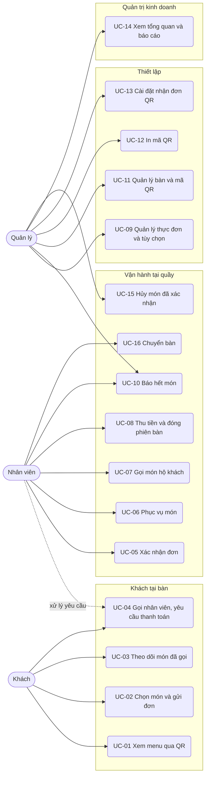
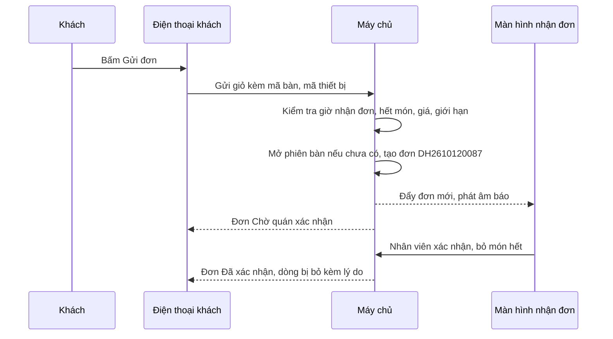

# Đặc tả use case — Menu QR Gọi món

> Use case phần nền (UC-SYS-01 đến UC-SYS-10): `ZDOCS/03-KIEN-TRUC/USE-CASE-NEN.md`.
> Mã FR, BR, SCR tham chiếu `02-SRS.md`.

---

## 1. Tác nhân

| Tác nhân | Mã vai trò | Use case chính |
| :--- | :--- | :--- |
| Khách | — (không đăng nhập) | UC-01, UC-02, UC-03, UC-04 |
| Nhân viên | `STAFF` | UC-04 (xử lý yêu cầu), UC-05, UC-06, UC-07, UC-08, UC-10, UC-16 |
| Quản lý | `MANAGER` | UC-09, UC-10, UC-11, UC-12, UC-13, UC-14, UC-15; làm được mọi việc của Nhân viên |
| Quản trị viên | `ADMIN` | Toàn bộ, cộng phần nền (thương hiệu hiển thị trên trang khách ở UC-SYS-07) |

---

## 2. Sơ đồ use case

---

## 3. Danh sách use case

| Mã | Tên | Tác nhân chính | Module | Ưu tiên | FR |
| :--- | :--- | :--- | :--- | :---: | :--- |
| UC-01 | Xem menu qua QR | Khách | Khách tại bàn | P1 | FR-02, FR-03, FR-04, FR-05 |
| UC-02 | Chọn món và gửi đơn | Khách | Khách tại bàn | P1 | FR-06, FR-07, FR-08, FR-09 |
| UC-03 | Theo dõi món đã gọi | Khách | Khách tại bàn | P1 | FR-10 |
| UC-04 | Gọi nhân viên, yêu cầu thanh toán | Khách | Khách tại bàn | P1 | FR-11, FR-12, FR-13, FR-14 |
| UC-05 | Xác nhận đơn | Nhân viên | Vận hành tại quầy | P1 | FR-15, FR-16, FR-17, FR-18 |
| UC-06 | Phục vụ món | Nhân viên | Vận hành tại quầy | P1 | FR-19 |
| UC-07 | Gọi món hộ khách | Nhân viên | Vận hành tại quầy | P2 | FR-20 |
| UC-08 | Thu tiền và đóng phiên bàn | Nhân viên | Vận hành tại quầy | P1 | FR-22, FR-23, FR-24 |
| UC-09 | Quản lý thực đơn và tùy chọn | Quản lý | Thiết lập | P1 | FR-26, FR-27, FR-28, FR-29 |
| UC-10 | Báo hết món | Nhân viên, Quản lý | Vận hành tại quầy | P1 | FR-30 |
| UC-11 | Quản lý bàn và mã QR | Quản lý | Thiết lập | P1 | FR-31, FR-32 |
| UC-12 | In mã QR | Quản lý | Thiết lập | P1 | FR-33 |
| UC-13 | Cài đặt nhận đơn QR | Quản lý | Thiết lập | P2 | FR-34 |
| UC-14 | Xem tổng quan và báo cáo | Quản lý | Quản trị kinh doanh | P2 | FR-01, FR-35, FR-36, FR-37 |
| UC-15 | Hủy món đã xác nhận | Quản lý | Vận hành tại quầy | P2 | FR-21 |
| UC-16 | Chuyển bàn | Nhân viên | Vận hành tại quầy | P3 | FR-25 |

---

## 4. Đặc tả chi tiết

### UC-01: Xem menu qua QR

| Mục | Nội dung |
| :--- | :--- |
| Tác nhân chính | Khách |
| Mô tả | Khách quét mã QR dán trên bàn để xem menu của quán trên điện thoại |
| Ưu tiên | P1 |
| Điều kiện kích hoạt | Khách ngồi vào bàn, mở camera quét mã QR |
| Tiền điều kiện | Bàn có mã bàn còn hiệu lực |
| Hậu điều kiện | Trang khách hiển thị menu của đúng bàn; chưa tạo phiên bàn |
| Yêu cầu liên quan | FR-02, FR-03, FR-04, FR-05, BR-01, BR-14, BR-17 |
| Màn hình | SCR-01 |

**Luồng chính**

1. Khách quét QR; điện thoại mở đường dẫn `/t/K7M2QX` trên trình duyệt.
2. Hệ thống kiểm tra mã bàn (BR-01), hiển thị đầu trang có logo, tên quán, "Bàn 05"; thanh danh mục cuộn ngang dính đầu trang.
3. Khách cuộn xem món theo danh mục; mỗi món có ảnh, tên, giá, mô tả ngắn, nhãn (Bán chạy, Món mới, Cay, Chay).
4. Chạm một danh mục trên thanh: trang cuộn tới danh mục đó.

**Luồng thay thế**

- 3a. Tìm món: chạm biểu tượng kính lúp, gõ "gỏi"; danh sách lọc theo tên khi đang gõ.
- 3b. Đổi ngôn ngữ (P3): chạm "EN"; tên danh mục, tên món, mô tả hiển thị bằng tiếng Anh nếu có.
- 1a. Khách đã có giỏ chưa gửi của bàn này trong 4 giờ qua: giỏ hiện lại ở nút "Giỏ món" (BR-05).

**Luồng ngoại lệ**

- E1. Mã bàn không tồn tại hoặc đã đổi: trang báo "Mã QR không hợp lệ hoặc đã hết hiệu lực, vui lòng gọi nhân viên", không hiện menu.
- E2. Món hết: hiển thị mờ, nhãn "Hết món", không có nút thêm (BR-14).
- E3. Bàn đang tắt, ngoài giờ nhận đơn hoặc quán tạm ngưng: menu vẫn hiển thị, dải thông báo vàng trên cùng nêu lý do không gửi được đơn (BR-07, BR-17).

### UC-02: Chọn món và gửi đơn

| Mục | Nội dung |
| :--- | :--- |
| Tác nhân chính | Khách |
| Mô tả | Khách chọn món, tùy chọn, số lượng, rồi gửi đơn cho quán |
| Ưu tiên | P1 |
| Điều kiện kích hoạt | Khách muốn gọi món hoặc gọi thêm |
| Tiền điều kiện | Đang mở trang khách của bàn; quán đang nhận đơn (BR-07) |
| Hậu điều kiện | Đơn mới mã `DH…` thuộc phiên bàn đang mở (tạo phiên nếu chưa có); giỏ trống |
| Yêu cầu liên quan | FR-06, FR-07, FR-08, FR-09, BR-02 đến BR-08 |
| Màn hình | SCR-01, SCR-02, SCR-03 |

**Luồng chính**

1. Khách chạm món "Cơm chiên dương châu"; hệ thống mở tấm trượt chi tiết: ảnh lớn, mô tả, nhóm "Thêm" (chọn tối đa 2), ô ghi chú, số lượng.
2. Khách chọn Trứng ốp la (+10.000 ₫), Lạp xưởng (+15.000 ₫); thành tiền tạm tính 90.000 ₫ (BR-03).
3. Bấm "Thêm vào giỏ"; nút "Giỏ món" ở cạnh dưới hiện số món và tổng tiền.
4. Lặp lại cho các món khác.
5. Khách mở Giỏ món: sửa số lượng, sửa tùy chọn, xóa dòng; nhập tên gọi "Anh Tuấn" và ghi chú chung (không bắt buộc).
6. Bấm "Gửi đơn"; hệ thống kiểm tra BR-05, BR-06, BR-07, tạo đơn, mở phiên bàn nếu bàn chưa có phiên.
7. Hệ thống chuyển sang trang Món đã gọi, hiển thị đơn mới trạng thái "Chờ quán xác nhận" hoặc "Đã xác nhận" (BR-08).

**Luồng thay thế**

- 2a. Món có nhóm "chọn một" bắt buộc có mặc định (Size M): lựa chọn mặc định được chọn sẵn.
- 2b. Món không có nhóm tùy chọn: bấm "+" trên thẻ món là thêm thẳng vào giỏ với số lượng 1.
- 3a. Thêm món giống hệt dòng đã có: cộng số lượng vào dòng cũ.
- 5a. Nhiều người cùng bàn: mỗi điện thoại có giỏ riêng, gửi đơn riêng; mọi đơn gom vào cùng phiên bàn.

**Luồng ngoại lệ**

- E1. Thiếu lựa chọn bắt buộc (vd "Mức cay" của Mì xào hải sản): nút "Thêm vào giỏ" khóa, nhóm báo đỏ "Bắt buộc chọn 1" (BR-04).
- E2. Chọn quá số tối đa: không cho chọn thêm, báo "Chọn tối đa 2".
- E3. Món hoặc lựa chọn vừa hết khi đang ở giỏ: không gửi được, dòng báo đỏ "Món vừa hết"; khách xóa dòng rồi gửi lại (BR-05).
- E4. Giá vừa đổi: báo "Giá đã thay đổi", giỏ cập nhật giá mới, khách bấm gửi lại.
- E5. Quán tạm ngưng, ngoài giờ, bàn tắt: không gửi được, báo lý do, giỏ giữ nguyên (BR-07, BR-17).
- E6. Bàn đã có 3 đơn chờ xác nhận: báo "Bàn đang có 3 đơn chờ quán xác nhận, vui lòng chờ" (BR-06).
- E7. Bấm "Gửi đơn" hai lần hoặc mạng chập chờn rồi gửi lại trong 10 giây: chỉ tạo một đơn (BR-06).

### UC-03: Theo dõi món đã gọi

| Mục | Nội dung |
| :--- | :--- |
| Tác nhân chính | Khách |
| Mô tả | Khách xem các đơn của cả bàn, món nào đã nhận, món nào không phục vụ được, tạm tính |
| Ưu tiên | P1 |
| Điều kiện kích hoạt | Khách vừa gửi đơn hoặc muốn kiểm tra trước khi thanh toán |
| Tiền điều kiện | Bàn có phiên đang mở |
| Hậu điều kiện | Không thay đổi dữ liệu |
| Yêu cầu liên quan | FR-10, BR-09, BR-10, BR-11 |
| Màn hình | SCR-04 |

**Luồng chính**

1. Khách chạm tab "Món đã gọi".
2. Hệ thống hiển thị các đơn của phiên bàn hiện tại, mới nhất trên cùng; mỗi đơn có mã, giờ gửi, tên gọi, trạng thái (Chờ quán xác nhận, Đã xác nhận, Đã phục vụ, Bị từ chối).
3. Mỗi đơn liệt kê món, tùy chọn, số lượng, thành tiền; dòng bị bỏ hiện gạch ngang kèm "Không phục vụ được: {lý do}".
4. Cuối trang hiển thị tạm tính theo BR-11 và nút "Yêu cầu thanh toán".
5. Trạng thái tự cập nhật khi quán xác nhận, phục vụ, không cần tải lại trang.

**Luồng thay thế**

- 2a. Đơn từ điện thoại khác cùng bàn: hiện cùng danh sách, ghi tên gọi nếu có.

**Luồng ngoại lệ**

- E1. Bàn chưa có phiên: trang hiện "Bàn chưa gọi món nào" và nút "Xem menu".
- E2. Có đơn đang chờ xác nhận: tạm tính không gồm đơn đó, ghi chú "Món chờ quán xác nhận chưa tính vào tạm tính".
- E3. Phiên vừa đóng: trang hiện "Cảm ơn quý khách, hẹn gặp lại", giỏ bị xóa (FR-24).

### UC-04: Gọi nhân viên, yêu cầu thanh toán

| Mục | Nội dung |
| :--- | :--- |
| Tác nhân chính | Khách |
| Tác nhân phụ | Nhân viên (xử lý yêu cầu) |
| Mô tả | Khách gọi nhân viên hoặc xin thanh toán từ điện thoại, không phải vẫy tay chờ |
| Ưu tiên | P1 |
| Điều kiện kích hoạt | Khách cần thêm đá, chén bát, dọn bàn, hoặc muốn tính tiền |
| Tiền điều kiện | Đang mở trang khách của bàn; yêu cầu thanh toán cần tạm tính lớn hơn 0 (BR-12) |
| Hậu điều kiện | Yêu cầu hiện trên màn hình nhận đơn; khách thấy trạng thái yêu cầu |
| Yêu cầu liên quan | FR-11, FR-12, FR-13, FR-14, BR-12, BR-20 |
| Màn hình | SCR-01, SCR-04, SCR-05 |

**Luồng chính (gọi nhân viên)**

1. Khách bấm nút "Gọi nhân viên" ở cạnh dưới trang.
2. Hệ thống hiện các lý do nhanh: Thêm đá, Lấy chén bát, Dọn bàn, Tư vấn món, Khác kèm ghi chú.
3. Khách chọn "Thêm đá", bấm "Gửi"; điện thoại hiện "Đã báo nhân viên, vui lòng chờ".
4. Màn hình nhận đơn phát âm báo, khu "Yêu cầu từ bàn" thêm dòng "Bàn 05 · Thêm đá · 0 phút".
5. Nhân viên mang đá ra, bấm "Đã xử lý"; điện thoại khách hiện "Nhân viên đã xử lý".

**Luồng thay thế**

- 1a. Yêu cầu thanh toán: khách bấm "Yêu cầu thanh toán" ở trang Món đã gọi, chọn Tiền mặt hoặc Chuyển khoản, đánh dấu "Cần xuất hóa đơn GTGT" nếu cần; phiên chuyển "Chờ thanh toán", tab Bàn của nhân viên tô vàng Bàn 05.
- 3a. Chọn chuyển khoản (P2): điện thoại hiện mã QR giả lập có số tiền bằng tạm tính, nội dung là mã phiên `PB…`, kèm dòng "Nhân viên sẽ xác nhận khi nhận được tiền" (FR-13).
- 4a. Yêu cầu chờ từ 3 phút: dòng yêu cầu chuyển đỏ, xếp đầu khu.

**Luồng ngoại lệ**

- E1. Gọi nhân viên lần nữa trong 60 giây: không tạo yêu cầu mới, hiện "Đã báo nhân viên, vui lòng chờ" (BR-12).
- E2. Yêu cầu thanh toán khi tạm tính bằng 0 (chưa có món được xác nhận): nút khóa, ghi chú "Chưa có món được quán xác nhận".
- E3. Khách gửi thêm đơn khi đang có yêu cầu thanh toán: yêu cầu thanh toán tự hủy, phiên về "Đang phục vụ"; khách gửi lại yêu cầu khi gọi xong.

### UC-05: Xác nhận đơn

| Mục | Nội dung |
| :--- | :--- |
| Tác nhân chính | Nhân viên |
| Mô tả | Kiểm tra đơn khách gửi, bỏ món không phục vụ được, xác nhận hoặc từ chối, in phiếu bếp |
| Ưu tiên | P1 |
| Điều kiện kích hoạt | Có đơn mới ở trạng thái "Chờ xác nhận" |
| Tiền điều kiện | Có quyền `orders.confirm` |
| Hậu điều kiện | Đơn "Đã xác nhận" và phiếu bếp được in, hoặc đơn "Bị từ chối"; khách thấy kết quả |
| Yêu cầu liên quan | FR-15, FR-16, FR-17, FR-18, BR-02, BR-08, BR-09, BR-10 |
| Màn hình | SCR-05, SCR-08 |

**Luồng chính**

1. Nhân viên mở Màn hình nhận đơn, tab Đơn; cột "Chờ xác nhận" bên trái, cột "Chờ phục vụ" bên phải.
2. Khách gửi đơn; trong 3 giây thẻ đơn xuất hiện ở cột "Chờ xác nhận", phát âm báo, tiêu đề tab trình duyệt đổi thành "(1) Nhận đơn".
3. Thẻ đơn có bàn, mã đơn, giờ gửi, đồng hồ thời gian chờ, tên gọi, món, tùy chọn, ghi chú, tổng tiền.
4. Nhân viên kiểm tra: quầy đã hết tắc, chạm dòng "Trà tắc", chọn "Bỏ món", lý do "Hết món" (BR-10).
5. Bấm "Xác nhận"; đơn chuyển "Đã xác nhận", sang cột "Chờ phục vụ"; hệ thống mở bản in phiếu bếp không có dòng bị bỏ.
6. Điện thoại khách cập nhật kết quả trong 5 giây.

**Luồng thay thế**

- 2a. Đơn tự xác nhận (BR-08): thẻ vào thẳng cột "Chờ phục vụ" với nhãn "Tự xác nhận", phiếu bếp vẫn mở bản in.
- 4a. Đơn không có gì cần bỏ: bấm "Xác nhận" luôn.
- 5a. Từ chối: bấm "Từ chối", chọn lý do (Bàn không có khách, Đơn trùng, Hết món, Khác kèm ghi chú); đơn "Bị từ chối", khách thấy lý do. Mọi đơn của phiên đều bị từ chối thì phiên tự hủy, bàn về Trống (BR-02).
- 5b. Tắt in phiếu bếp: đơn vẫn xác nhận, in lại được từ thẻ đơn.

**Luồng ngoại lệ**

- E1. Bỏ hết món trong đơn: nút "Xác nhận" khóa, gợi ý dùng "Từ chối" (BR-10).
- E2. Đơn chờ từ 5 phút: thẻ vàng; từ 10 phút: thẻ đỏ, xếp đầu cột (BR-09).
- E3. Hai nhân viên cùng xử lý một đơn: người sau nhận thông báo "Đơn đã được {tên} xử lý", thẻ cập nhật theo kết quả của người trước.

### UC-06: Phục vụ món

| Mục | Nội dung |
| :--- | :--- |
| Tác nhân chính | Nhân viên |
| Mô tả | Ghi nhận món đã mang ra bàn để khách và quán cùng biết món nào còn chờ |
| Ưu tiên | P1 |
| Điều kiện kích hoạt | Bếp, quầy pha chế làm xong món |
| Tiền điều kiện | Đơn "Đã xác nhận"; có quyền `orders.serve` |
| Hậu điều kiện | Dòng đơn "Đã phục vụ"; đơn "Đã phục vụ" khi mọi món còn hiệu lực đã phục vụ |
| Yêu cầu liên quan | FR-19, BR-09 |
| Màn hình | SCR-05 |

**Luồng chính**

1. Nhân viên xem cột "Chờ phục vụ"; thẻ đơn xếp theo thời gian chờ, lâu nhất trên cùng.
2. Mang món ra bàn, chạm "Đã phục vụ" ở từng dòng hoặc "Phục vụ cả đơn".
3. Dòng chuyển "Đã phục vụ"; khi mọi dòng còn hiệu lực đã phục vụ, đơn chuyển "Đã phục vụ" và rời cột.
4. Trang Món đã gọi của khách cập nhật trạng thái.

**Luồng thay thế**

- 2a. Bấm nhầm: thông báo nổi có nút "Hoàn tác" trong 10 giây.

**Luồng ngoại lệ**

- E1. Đơn "Chờ xác nhận": không có nút "Đã phục vụ", phải xác nhận trước.
- E2. Dòng bị bỏ hoặc đã hủy: không hiện nút "Đã phục vụ", không tính khi xét đơn đã phục vụ đủ.

### UC-07: Gọi món hộ khách

| Mục | Nội dung |
| :--- | :--- |
| Tác nhân chính | Nhân viên |
| Mô tả | Nhân viên ghi món cho khách không dùng điện thoại, đơn vào cùng phiên bàn |
| Ưu tiên | P2 |
| Yêu cầu liên quan | FR-20, BR-02, BR-08 |
| Màn hình | SCR-07 |

**Luồng chính**

1. Ở tab Bàn, nhân viên chạm bàn, bấm "Gọi món hộ".
2. Hệ thống mở hộp thoại thực đơn dạng lưới, chọn món, tùy chọn, số lượng như trang khách.
3. Bấm "Gửi"; đơn tạo với nguồn "Nhân viên", trạng thái "Đã xác nhận", mở phiên bàn nếu chưa có, in phiếu bếp.

### UC-08: Thu tiền và đóng phiên bàn

| Mục | Nội dung |
| :--- | :--- |
| Tác nhân chính | Nhân viên |
| Mô tả | Kiểm tra tạm tính, thu tiền mặt hoặc chuyển khoản, in hóa đơn, trả bàn |
| Ưu tiên | P1 |
| Điều kiện kích hoạt | Khách yêu cầu thanh toán trên điện thoại hoặc ra quầy trả tiền |
| Tiền điều kiện | Bàn có phiên đang mở; có quyền `table-sessions.checkout` |
| Hậu điều kiện | Phiên "Đã đóng", bàn Trống, điện thoại khách hiện lời cảm ơn |
| Yêu cầu liên quan | FR-22, FR-23, FR-24, BR-11, BR-13, BR-20 |
| Màn hình | SCR-05, SCR-06, SCR-08 |

**Luồng chính**

1. Nhân viên mở tab Bàn; bàn có yêu cầu thanh toán tô vàng, ghi phương thức khách chọn và "Cần HĐ GTGT" nếu có.
2. Chạm Bàn 05; ngăn kéo chi tiết phiên mở ra: mã phiên, giờ mở, các đơn, món, món bị bỏ, tạm tính.
3. Bấm "Thu tiền", chọn phương thức:
   - Tiền mặt: nhập tiền khách đưa hoặc bấm nút nhanh (Đủ tiền, 100.000, 200.000, 500.000); hệ thống hiện tiền thối.
   - Chuyển khoản: hiện QR giả lập có số tiền bằng tạm tính, nội dung mã phiên; nhân viên bấm "Đã nhận tiền".
4. Bấm "Hoàn tất"; hệ thống đóng phiên, mở bản in hóa đơn khổ 80 mm có số hóa đơn là mã phiên.
5. Bàn về Trống; yêu cầu đang chờ của bàn tự chuyển "Đã xử lý"; điện thoại khách hiện "Cảm ơn quý khách, hẹn gặp lại" và xóa giỏ.

**Luồng thay thế**

- 1a. Khách ra quầy trả tiền, không gửi yêu cầu: nhân viên chạm bàn ở tab Bàn, tiếp tục bước 2.
- 4a. Không in: hóa đơn vẫn lưu, in lại được từ chi tiết phiên đã đóng trong ngày.

**Luồng ngoại lệ**

- E1. Còn đơn "Chờ xác nhận": nút "Thu tiền" khóa, báo "Còn {n} đơn chờ xác nhận" (BR-13).
- E2. Còn món đã xác nhận chưa phục vụ: cảnh báo "Còn {n} món chưa phục vụ"; nhân viên xác nhận để tiếp tục, hoặc nhờ quản lý hủy món (UC-15).
- E3. Tiền khách đưa nhỏ hơn tạm tính: nút "Hoàn tất" khóa, hiện "Còn thiếu {số tiền}".
- E4. Mất kết nối khi bấm "Hoàn tất": báo "Chưa đóng được phiên, thử lại"; bấm lại không tạo trùng hóa đơn.

### UC-09: Quản lý thực đơn và tùy chọn

| Mục | Nội dung |
| :--- | :--- |
| Tác nhân chính | Quản lý |
| Mô tả | Thêm, sửa, ẩn danh mục, món, nhóm tùy chọn; đổi giá, khách thấy ngay mà không in lại menu |
| Ưu tiên | P1 |
| Điều kiện kích hoạt | Quán đổi món, đổi giá, thêm món mới |
| Tiền điều kiện | Có quyền `menu-items.create` hoặc `menu-items.update` |
| Hậu điều kiện | Trang khách hiển thị thực đơn mới ở lần tải kế tiếp |
| Yêu cầu liên quan | FR-26, FR-27, FR-28, FR-29, BR-04, BR-16 |
| Màn hình | SCR-09 |

**Luồng chính (thêm món có nhóm tùy chọn)**

1. Quản lý mở Thực đơn, tab Nhóm tùy chọn, bấm "Thêm nhóm".
2. Nhập tên "Mức đá", kiểu "Chọn một", không bắt buộc; thêm lựa chọn "Ít đá" 0 ₫, "Không đá" 0 ₫; Lưu.
3. Sang tab Món, bấm "Thêm món": mã `M051`, tên "Cà phê sữa đá", danh mục Cà phê, ảnh, mô tả, giá 29.000 ₫, nhãn "Bán chạy".
4. Gắn nhóm "Mức đá"; kéo thả thứ tự nhóm nếu món có nhiều nhóm.
5. Bấm "Lưu"; khung xem trước bên phải hiển thị món như trên điện thoại khách.

**Luồng thay thế**

- 1a. Tab Danh mục: thêm, đổi tên, kéo thả thứ tự, ẩn danh mục.
- 3a. Sửa giá món đang bán: trang khách hiển thị giá mới; giỏ của khách đang có món đó được cập nhật khi gửi (BR-05); đơn đã gửi giữ giá cũ.
- 5a. Ẩn món: món biến khỏi trang khách nhưng vẫn có trong báo cáo.

**Luồng ngoại lệ**

- E1. Mã món trùng: báo lỗi tại ô mã.
- E2. Giá món hoặc giá lựa chọn không phải bội số 1.000 ₫, giá món bằng 0: báo lỗi, không lưu.
- E3. Nhóm "chọn nhiều" có số tối đa ngoài 1–10 hoặc lớn hơn số lựa chọn: báo lỗi.
- E4. Xóa món đã từng được gọi: hệ thống từ chối, gợi ý dùng "Ẩn" (BR-16).

### UC-10: Báo hết món

| Mục | Nội dung |
| :--- | :--- |
| Tác nhân chính | Nhân viên |
| Tác nhân phụ | Quản lý |
| Mô tả | Đánh dấu món hoặc lựa chọn hết để khách không gọi được nữa |
| Ưu tiên | P1 |
| Điều kiện kích hoạt | Bếp, quầy báo hết nguyên liệu |
| Tiền điều kiện | Có quyền `menu-items.availability` |
| Hậu điều kiện | Trang khách hiển thị món mờ "Hết món" trong 5 giây |
| Yêu cầu liên quan | FR-30, BR-05, BR-14 |
| Màn hình | SCR-09 |

**Luồng chính**

1. Nhân viên mở Thực đơn, tìm "Trà tắc".
2. Bấm công tắc "Còn món"; hệ thống hỏi "Hết trong hôm nay" hay "Hết tới khi mở lại".
3. Chọn "Hết trong hôm nay"; món chuyển "Hết món".
4. Trong 5 giây, trang khách đang mở hiển thị Trà tắc mờ, nhãn "Hết món".

**Luồng thay thế**

- 1a. Hết một lựa chọn: mở món, bấm công tắc cạnh lựa chọn (vd Size L của Trà tắc); khách chỉ còn chọn được Size M.
- 3a. Bán lại: bật công tắc về "Còn món".
- 1b. Bỏ món lý do "Hết món" lúc xác nhận đơn (UC-05) tự chuyển món "Hết trong hôm nay" (BR-10).

**Luồng ngoại lệ**

- E1. Nhân viên không có quyền sửa thực đơn: chỉ thấy công tắc "Còn món", không có nút sửa, thêm, xóa.
- E2. Khách có món đó trong giỏ: khi gửi bị chặn dòng đó (UC-02 E3).

### UC-11: Quản lý bàn và mã QR

| Mục | Nội dung |
| :--- | :--- |
| Tác nhân chính | Quản lý |
| Mô tả | Khai báo bàn, cấp mã QR riêng từng bàn, bật tắt bàn, đổi mã QR khi cần |
| Ưu tiên | P1 |
| Điều kiện kích hoạt | Quán mới dùng hệ thống, thêm bàn, tấm QR bị chụp lại để đặt bậy |
| Tiền điều kiện | Có quyền `tables.create` hoặc `tables.update` |
| Hậu điều kiện | Mỗi bàn có mã bàn và đường dẫn QR còn hiệu lực |
| Yêu cầu liên quan | FR-31, FR-32, BR-01, BR-17 |
| Màn hình | SCR-10 |

**Luồng chính (thêm bàn)**

1. Quản lý mở Bàn và QR; hệ thống hiển thị danh sách bàn theo khu vực, mỗi dòng có tên bàn, sức chứa, mã bàn, ảnh QR thu nhỏ, trạng thái (Trống, Đang phục vụ, Chờ thanh toán, Tắt).
2. Bấm "Thêm bàn", nhập tên "Bàn 21", khu vực "Ngoài sân", sức chứa 4.
3. Bấm "Lưu"; hệ thống cấp mã bàn 6 ký tự theo BR-01, tạo ảnh QR.
4. Quản lý bấm "Mở trang khách" để thử; trang khách của Bàn 21 mở ở tab mới.

**Luồng thay thế**

- 1a. Sửa bàn: đổi tên, khu vực, sức chứa; mã QR giữ nguyên.
- 1b. Đổi mã QR (P2): chọn bàn, bấm "Đổi mã QR", xác nhận; mã mới thay mã cũ, tấm QR cũ hết hiệu lực ngay, cần in lại (UC-12).
- 1c. Tắt bàn: bàn không nhận đơn qua QR; khách quét thấy thông báo (BR-17).

**Luồng ngoại lệ**

- E1. Tên bàn trùng hoặc sức chứa ngoài 1–20: báo lỗi tại ô nhập.
- E2. Tắt, xóa hoặc đổi mã QR của bàn đang có phiên mở: hệ thống từ chối, báo "Bàn đang có khách".

### UC-12: In mã QR

| Mục | Nội dung |
| :--- | :--- |
| Tác nhân chính | Quản lý |
| Mô tả | In mã QR để dán hoặc dựng tại bàn, tải ảnh để gửi nhà in |
| Ưu tiên | P1 |
| Điều kiện kích hoạt | Thêm bàn mới, đổi mã QR, tấm QR cũ hỏng |
| Tiền điều kiện | Có quyền `tables.print-qr` |
| Hậu điều kiện | Bản in hoặc ảnh PNG của mã QR đã chọn |
| Yêu cầu liên quan | FR-33, BR-01, NFR-05 |
| Màn hình | SCR-10, SCR-11 |

**Luồng chính**

1. Ở Bàn và QR, quản lý tick chọn một hoặc nhiều bàn (vd Bàn 01 đến Bàn 08), bấm "In QR".
2. Chọn mẫu: thẻ dựng A6 (1 mã mỗi trang), tem dán 8×8 cm, tờ A4 4 mã.
3. Hệ thống hiển thị bản xem trước: mỗi mã có logo, tên quán, tên bàn, câu "Quét để xem menu và gọi món", cạnh mã QR tối thiểu 3 cm.
4. Bấm "In"; trình duyệt mở hộp thoại in.

**Luồng thay thế**

- 1a. Tải ảnh: bấm biểu tượng tải ở một bàn, nhận file PNG tên `qr-ban-05.png`.

**Luồng ngoại lệ**

- E1. Chưa chọn bàn nào: nút "In QR" khóa.
- E2. Có bàn đang tắt trong danh sách chọn: bản xem trước gắn cảnh báo "Bàn đang tắt, khách quét sẽ không gửi đơn được".

### UC-13: Cài đặt nhận đơn QR

| Mục | Nội dung |
| :--- | :--- |
| Tác nhân chính | Quản lý |
| Mô tả | Đặt giờ nhận đơn, chế độ xác nhận, tạm ngưng nhận đơn khi bếp quá tải |
| Ưu tiên | P2 |
| Yêu cầu liên quan | FR-34, BR-07, BR-08 |
| Màn hình | SCR-10 |

**Luồng chính**

1. Quản lý mở Bàn và QR, tab Cài đặt nhận đơn.
2. Đặt giờ nhận đơn (mặc định 09:00–22:00), chọn chế độ xác nhận: "Thủ công" hoặc "Tự xác nhận khi bàn đã có đơn được xác nhận".
3. Bấm "Lưu"; áp dụng ngay cho đơn gửi sau đó.
4. Khi bếp quá tải, bấm "Tạm ngưng nhận đơn", chọn 15 phút, 30 phút hoặc "Tới khi mở lại"; trang khách hiện dải thông báo kèm giờ nhận lại.

### UC-14: Xem tổng quan và báo cáo

| Mục | Nội dung |
| :--- | :--- |
| Tác nhân chính | Quản lý |
| Mô tả | Nắm tình hình hôm nay, phân tích doanh thu, món, tốc độ phục vụ |
| Ưu tiên | P2 |
| Yêu cầu liên quan | FR-01, FR-35, FR-36, FR-37, BR-19 |
| Màn hình | SCR-12, SCR-13 |

**Luồng chính**

1. Quản lý đăng nhập; Tổng quan hiển thị bàn đang mở phiên, đơn chờ xác nhận, yêu cầu chưa xử lý, doanh thu, số phiên đã đóng, giá trị trung bình phiên, thời gian xác nhận trung bình.
2. Mở Báo cáo; mặc định tab Doanh thu, 30 ngày gần nhất, có đường kỳ trước làm nền.
3. Chuyển sang tab Món (món gọi nhiều, món bị bỏ và lý do) và tab Vận hành (thời gian xác nhận, thời gian xử lý yêu cầu, tỉ lệ từ chối, tỉ lệ khách tự gọi, bảng nhiệt giờ × thứ).
4. Đổi khoảng ngày; số liệu cập nhật.

### UC-15: Hủy món đã xác nhận

| Mục | Nội dung |
| :--- | :--- |
| Tác nhân chính | Quản lý |
| Mô tả | Hủy món khách không lấy sau khi đơn đã xác nhận |
| Ưu tiên | P2 |
| Yêu cầu liên quan | FR-21, BR-11, BR-15 |
| Màn hình | SCR-06 |

**Luồng chính**

1. Quản lý mở chi tiết phiên bàn, chạm món đã xác nhận, bấm "Hủy món".
2. Chọn số lượng hủy, nhập lý do; xác nhận.
3. Món chuyển "Đã hủy", tạm tính giảm; trang Món đã gọi của khách hiện dòng gạch ngang.
