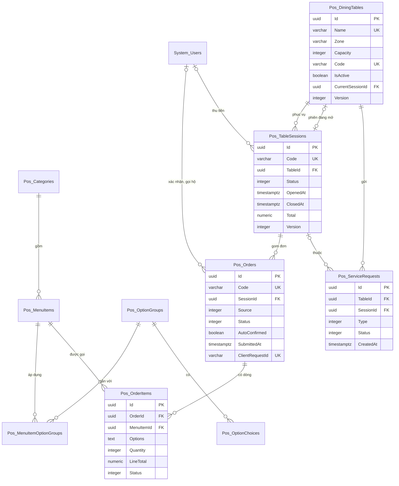

# Thiết kế CSDL — Menu QR Gọi món

> Database: `WebDemo_FnbMenuQr` (Postgres).
> Quy ước chung và nhóm bảng nền `System_*` (tài khoản, vai trò, quyền, cài đặt, nhật ký): xem `ZDOCS/03-KIEN-TRUC/THIET-KE-CSDL-NEN.md`.
> File này chỉ mô tả **bảng nghiệp vụ riêng của dự án**. Area: `Pos` (thực đơn, bàn và QR, phiên bàn, đơn, yêu cầu từ bàn).
> Mã FR, BR, TC tham chiếu `02-SRS.md` và `05-KICH-BAN-KIEM-THU.md`. Hợp đồng API, công thức tính tiền, quy ước FE: `07-DANH-SACH-API.md`.

---

## 1. Sơ đồ

Cài đặt nhận đơn (giờ nhận đơn, chế độ xác nhận, tạm ngưng) không có bảng riêng: lưu ở `System_Settings` nhóm "Nhận đơn QR" (§3).

---

## 2. Danh sách bảng

| Bảng | Area | Mô tả | Xóa | Dữ liệu mẫu |
| :--- | :--- | :--- | :--- | :---: |
| `Pos_Categories` | Pos | Danh mục món trên trang khách | Mềm, chặn khi còn món | 6 |
| `Pos_MenuItems` | Pos | Món | Mềm, chặn khi đã từng được gọi (BR-16) | 50 |
| `Pos_OptionGroups` | Pos | Nhóm tùy chọn dùng chung | Mềm, chặn khi đang gắn với món | 6 |
| `Pos_OptionChoices` | Pos | Lựa chọn trong nhóm | Mềm (qua `PUT` nhóm) | 16 |
| `Pos_MenuItemOptionGroups` | Pos | Nhóm tùy chọn áp dụng cho món, có thứ tự (bảng nối) | Cứng | 25 |
| `Pos_DiningTables` | Pos | Bàn, mã bàn trong QR | Mềm, chặn khi đang có phiên mở (BR-17) | 20 |
| `Pos_TableSessions` | Pos | Phiên bàn, cũng là hóa đơn khi đóng | Không xóa | 1.335 |
| `Pos_Orders` | Pos | Đơn (một lần gửi món) | Không xóa | 2.127 |
| `Pos_OrderItems` | Pos | Dòng đơn, chụp tên, giá, lựa chọn lúc gửi | Không xóa | 6.618 |
| `Pos_ServiceRequests` | Pos | Gọi nhân viên, yêu cầu thanh toán | Không xóa | 1.498 |

Số phiên, đơn, dòng, yêu cầu là số seeder suy ra từ `FE/src/mock/seed/demo-data.json` (§5); chi tiết ở §5.6.

---

## 3. Quy ước chung của dự án

- Mọi bảng có cột chung `Id`, `CreatedAt`, `CreatedBy`, `UpdatedAt`, `UpdatedBy` theo `THIET-KE-CSDL-NEN.md` §1; bảng xóa mềm có thêm `IsDeleted`. Cột unique của bảng xóa mềm dùng index lọc bản ghi chưa xóa (`.IsUnique().WhereNotDeleted()`), trừ `Pos_DiningTables.Code` unique trên **mọi** dòng để mã của bàn đã xóa không bao giờ dùng lại.
- Tiền `numeric(18,2)`, luôn là số nguyên đồng. Giá món là bội số 1.000 ₫ và lớn hơn 0; giá cộng thêm của lựa chọn là bội số 1.000 ₫, từ 0 (BR-16). Số lượng dòng đơn `integer` 1–20 (BR-03). Không có thuế, phí phục vụ, giảm giá: giá đã gồm thuế GTGT (SRS §2.4).
- Thời gian lưu UTC. "Ngày" trong mã chứng từ, "Hết trong hôm nay", giờ nhận đơn, báo cáo tính theo giờ Việt Nam (`VietnamTime`, chép từ demo Quản lý Nhà hàng).
- Enum lưu `integer`, API trả chuỗi PascalCase không dấu (cùng tên enum C#, bảng tra ở `07` §2).
- Người thao tác được chụp vào bản ghi (`…Id` + `…Name` là họ tên) để báo cáo, bản in không phụ thuộc tài khoản.
- **Khóa lạc quan**: `Pos_DiningTables.Version`, `Pos_TableSessions.Version`, `Pos_Orders.Version` là concurrency token (`IsConcurrencyToken()`), service tăng 1 ở mỗi thay đổi (quy tắc ở `07` §3.6).
- **Chống trùng** (BR-06, UC-08 E4): gửi đơn và gọi món hộ có `Pos_Orders.ClientRequestId`; gửi yêu cầu có `Pos_ServiceRequests.ClientRequestId`; thu tiền có `Pos_TableSessions.CheckoutRequestId`. Gửi lại cùng mã trả kết quả cũ (`07` §3.7). Ngoài ra cùng điện thoại gửi lại cùng giỏ trong 10 giây cũng trả đơn cũ, so bằng `Pos_Orders.CartKey`.
- Mã chứng từ sinh trong service, trong transaction (SRS §5.3, BR-20): đơn `DH` + `yyMMdd` (ngày gửi) + 4 số thứ tự trong ngày; phiên `PB` + `yyMMdd` (ngày mở) + 4 số. Trùng mã do hai request cùng lúc thì index unique báo lỗi, service thử lại một lần.
- Phiên bàn, đơn, dòng đơn, yêu cầu **không bao giờ xóa**, chỉ đổi trạng thái. Các bảng này đánh dấu `IAuditLogExempt` (ghi rất nhiều, bản ghi đã tự lưu người và giờ thao tác); thực đơn, bàn, cài đặt vẫn ghi nhật ký. Đặt lại dữ liệu demo xóa cứng toàn bộ bảng `Pos_*` (bảng con trước) rồi nạp lại.
- Cài đặt dùng chung lưu ở `System_Settings` (giá trị mẫu trong `FE/src/mock/seed/project.json`; nhãn tiếng Việt ở `FE/src/config/setting-labels.ts`):

| Khóa | Nhóm | Giá trị mẫu | Ghi chú |
| :--- | :--- | :--- | :--- |
| `Store.Name` | Quán | `Quán Vườn Dừa` | Đầu trang khách (FR-02), bản in QR, hóa đơn |
| `Store.Tagline` | Quán | `Món miền Tây, lẩu, bia lạnh dưới tán dừa` | Dòng nhỏ dưới tên quán trên trang khách, có thể trống |
| `Store.Address`, `Store.Phone`, `Store.TaxCode`, `Store.ReceiptFooter` | Quán | `64 Hà Huy Tập, Thanh Khê, Đà Nẵng`, `0236 3 779 779`, `0402345678`, `Cảm ơn quý khách, hẹn gặp lại!` | In trên hóa đơn |
| `Store.BankBin`, `Store.BankAccount`, `Store.BankAccountName` | Quán | `970422`, `0000000000`, `QUAN VUON DUA` | QR chuyển khoản giả lập (FR-13, FR-23) |
| `Ordering.OpenTime`, `Ordering.CloseTime` | Nhận đơn QR | `09:00`, `22:00` | `HH:mm` giờ Việt Nam (BR-07). Bằng nhau: nhận đơn cả ngày; giờ kết thúc nhỏ hơn: qua đêm (vd `16:00`–`02:00`) |
| `Ordering.ConfirmMode` | Nhận đơn QR | `TuXacNhan` | `ThuCong` hoặc `TuXacNhan` (BR-08) |
| `Ordering.PausedUntil` | Nhận đơn QR | rỗng | Rỗng: đang nhận đơn; `manual`: tạm ngưng tới khi mở lại; thời điểm ISO UTC: tạm ngưng tới lúc đó, quá giờ tự nhận lại (BR-07) |

  Tên quán, logo, màu trên trang khách: `Store.Name`, `Brand.LogoUrl` (`/logo/logo-mark.svg`), `Brand.PrimaryColor` (`#15803D`). Các con số cố định khác là hằng số trong code (`PosRules`, BE và FE cùng giá trị): tối đa 30 dòng mỗi đơn, 20 mỗi dòng, 3 đơn chờ mỗi bàn, cùng giỏ trong 10 giây (BR-06); gọi nhân viên lặp trong 60 giây; yêu cầu chờ từ 3 phút đỏ (BR-12); đơn chờ từ 5 phút vàng, 10 phút đỏ (BR-09); giỏ giữ 4 giờ (BR-05); hoàn tác "Đã phục vụ" 60 giây phía máy chủ; khách xem phiên vừa kết thúc trong 4 giờ.
- Ảnh món mẫu: `/seed/menu/{maMon}.webp` (vd `/seed/menu/M010.webp`), FE phục vụ từ `FE/public/seed/menu/`; seed chỉ ghi tên file ở trường `image`, seeder và FE mock ghép thành đường dẫn. Ảnh tải lên qua giao diện lưu `/uploads/menu/{yyyy}/{MM}/{guid}.{ext}` theo `IFileStorage` nền. Món chưa có ảnh (`ImageUrl` null) FE hiện ô màu theo `Pos_Categories.Color` kèm chữ viết tắt.

---

## 4. Mô tả bảng

### `Pos_Categories`: danh mục món

| Cột | Kiểu | Ràng buộc | Ghi chú |
| :--- | :--- | :--- | :--- |
| `Code` | `varchar(10)` | unique trong bản ghi chưa xóa, `^[A-Z0-9]{2,10}$` | `KV`, `MC`…; seed tham chiếu |
| `Name` | `varchar(100)` | bắt buộc | |
| `NameEn` | `varchar(100)` | | Tên tiếng Anh (FR-05, P3) |
| `Color` | `varchar(7)` | `#RRGGBB` | Nền ô ảnh mặc định, chấm màu ở trang quản lý |
| `SortOrder` | `integer` | | `PUT /api/categories/order` đánh lại 10, 20, 30… |
| `IsHidden` | `boolean` | mặc định 0 | Ẩn khỏi trang khách và gọi món hộ (FR-26), món vẫn trong báo cáo |
| `IsDeleted` | `boolean` | mặc định 0 | Chỉ xóa khi không còn món chưa xóa |

### `Pos_MenuItems`: món

| Cột | Kiểu | Ràng buộc | Ghi chú |
| :--- | :--- | :--- | :--- |
| `Code` | `varchar(10)` | unique trong bản ghi chưa xóa, `^M\d{3}$` | `M001`; trùng → 409 (UC-09 E1) |
| `Name` | `varchar(150)` | bắt buộc | |
| `NameEn` | `varchar(150)` | | P3 |
| `CategoryId` | `uuid` | FK `Pos_Categories`, chặn xóa | Index `(CategoryId, SortOrder)` |
| `ImageUrl` | `varchar(500)` | | `/seed/menu/M010.webp` hoặc `/uploads/menu/...` |
| `Description` | `varchar(500)` | | Mô tả ngắn trên thẻ món, đủ trong tấm chi tiết |
| `DescriptionEn` | `varchar(500)` | | P3 |
| `Unit` | `varchar(20)` | bắt buộc | `phần`, `đĩa`, `ly`, `lon`, `nồi`… hiện "22.000 ₫/lon" |
| `Price` | `numeric(18,2)` | > 0, bội số 1.000 | Đã gồm thuế (BR-16) |
| `Tags` | `varchar(100)` | | Mảng JSON tên enum `MenuTag`, vd `["BanChay","Cay"]`; DTO trả `MenuTag[]` |
| `SoldOutMode` | `integer` | null | Enum `SoldOutMode`; null là còn món |
| `SoldOutUntil` | `timestamptz` | null | Với `HetHomNay`: 00:00 ngày kế tiếp giờ Việt Nam (BR-14); với `HetToiKhiMoLai`: null |
| `IsHidden` | `boolean` | mặc định 0 | Ẩn khỏi trang khách, vẫn trong báo cáo |
| `SortOrder` | `integer` | | Thứ tự trong danh mục |
| `IsDeleted` | `boolean` | mặc định 0 | Từ chối khi đã có trong `Pos_OrderItems` (BR-16, TC-33) |

Món hết **hiệu lực** khi `SoldOutMode` khác null và (`SoldOutUntil` null hoặc hiện tại < `SoldOutUntil`); quá hạn không cần job, service và FE mock đọc lười, lần ghi kế tiếp xóa hai cột. DTO còn tính thêm: món có nhóm "chọn một" bắt buộc mà mọi lựa chọn đều hết thì cũng `isSoldOut` (BR-14). `status`: `An` khi `IsHidden`, `HetMon` khi hết, còn lại `DangBan`.

Enum `MenuTag` (lưu chuỗi trong JSON): `BanChay` Bán chạy, `MonMoi` Món mới, `Cay` Cay, `Chay` Chay.

Enum `SoldOutMode`: `0 HetHomNay` Hết trong hôm nay, `1 HetToiKhiMoLai` Hết tới khi mở lại.

### `Pos_OptionGroups`: nhóm tùy chọn

| Cột | Kiểu | Ràng buộc | Ghi chú |
| :--- | :--- | :--- | :--- |
| `Name` | `varchar(100)` | bắt buộc | Tên khách thấy: "Size", "Thêm", "Mức cay"; không bắt buộc duy nhất |
| `NameEn` | `varchar(100)` | | P3 |
| `SelectionType` | `integer` | | Enum `SelectionType` |
| `IsRequired` | `boolean` | | Chỉ có nghĩa với `ChonMot`; `ChonNhieu` luôn lưu 0 (BR-04: chọn từ 0) |
| `MaxSelect` | `integer` | `ChonMot` = 1; `ChonNhieu` 1–10 và ≤ số lựa chọn | BR-04, UC-09 E3 |
| `SortOrder` | `integer` | | Thứ tự trong tab Nhóm tùy chọn |
| `IsDeleted` | `boolean` | mặc định 0 | Chặn khi còn món chưa xóa gắn nhóm |

Enum `SelectionType`: `0 ChonMot` Chọn một, `1 ChonNhieu` Chọn nhiều.

### `Pos_OptionChoices`: lựa chọn

| Cột | Kiểu | Ràng buộc | Ghi chú |
| :--- | :--- | :--- | :--- |
| `OptionGroupId` | `uuid` | FK `Pos_OptionGroups`, có index `(OptionGroupId, SortOrder)` | |
| `Name` | `varchar(100)` | bắt buộc | |
| `NameEn` | `varchar(100)` | | P3 |
| `Price` | `numeric(18,2)` | ≥ 0, bội số 1.000 | Giá cộng thêm (TC-33) |
| `IsDefault` | `boolean` | mặc định 0 | Chỉ nhóm `ChonMot`, tối đa 1 lựa chọn mỗi nhóm |
| `SoldOutMode` | `integer` | null | Như món (FR-30, TC-35) |
| `SoldOutUntil` | `timestamptz` | null | Như món |
| `SortOrder` | `integer` | | Theo thứ tự gửi lên trong `PUT` nhóm |
| `IsDeleted` | `boolean` | mặc định 0 | Lựa chọn bị bỏ khỏi nhóm thì xóa mềm; dòng đơn cũ vẫn giữ bản chụp |

Lựa chọn hết áp cho **mọi món** dùng nhóm đó (nhóm dùng chung, FR-28); FE ghi rõ ở công tắc.

### `Pos_MenuItemOptionGroups`: nhóm tùy chọn của món

Bảng nối thuần, không có `Id` và cột chung `CreatedAt…` (sửa qua món). Khóa ghép (`MenuItemId`, `OptionGroupId`), cả hai FK xóa theo; cột `SortOrder integer` là thứ tự nhóm trên tấm chi tiết món (UC-09 bước 4). Index `OptionGroupId` để đếm món đang dùng nhóm.

### `Pos_DiningTables`: bàn

| Cột | Kiểu | Ràng buộc | Ghi chú |
| :--- | :--- | :--- | :--- |
| `Name` | `varchar(50)` | unique trong bản ghi chưa xóa, bắt buộc | "Bàn 05"; trùng → 409 "Tên bàn đã tồn tại" (UC-11 E1) |
| `Zone` | `varchar(50)` | bắt buộc | Khu vực nhập tự do, FE gợi ý khu đã có ("Trong nhà", "Ngoài sân") |
| `Capacity` | `integer` | 1–20 | BR-17 |
| `Code` | `varchar(6)` | unique trên mọi dòng, `^[A-HJKMNP-Z2-9]{6}$` | Mã bàn trong QR (BR-01): 6 ký tự ngẫu nhiên từ `ABCDEFGHJKMNPQRSTUVWXYZ23456789` (bỏ O, I, L, 0, 1), sinh bằng `RandomNumberGenerator` tới khi không trùng |
| `CodeChangedAt` | `timestamptz` | null | Lần đổi mã gần nhất (FR-32) |
| `IsActive` | `boolean` | mặc định 1 | Bàn tắt: khách xem menu, không gửi đơn, không gửi yêu cầu (BR-17) |
| `SortOrder` | `integer` | | Thứ tự trong khu; khu xếp theo `SortOrder` nhỏ nhất của khu |
| `CurrentSessionId` | `uuid` | null, FK `Pos_TableSessions` | Phiên đang mở; bảo đảm mỗi bàn tối đa một phiên mở (BR-02) |
| `Version` | `integer` | concurrency token | Hai điện thoại cùng gửi đơn đầu: request sau thua, đọc lại và gửi vào phiên vừa mở |
| `IsDeleted` | `boolean` | mặc định 0 | Chặn khi có phiên mở; QR của bàn đã xóa báo mã không hợp lệ |

Trạng thái bàn **không lưu**, API suy ra (`TableStatus`): `Tat` khi `IsActive = 0`; `DangPhucVu` / `ChoThanhToan` theo `Status` của phiên `CurrentSessionId`; còn lại `Trong`. Bàn đang có phiên không tắt, không xóa, không đổi mã QR được (UC-11 E2: 400 "Bàn đang có khách").

Enum `TableStatus` (chỉ trong DTO): `Trong`, `DangPhucVu`, `ChoThanhToan`, `Tat`.

### `Pos_TableSessions`: phiên bàn

| Cột | Kiểu | Ràng buộc | Ghi chú |
| :--- | :--- | :--- | :--- |
| `Code` | `varchar(20)` | unique | `PB` + `yyMMdd` + 4 số, cấp khi mở; là số hóa đơn và nội dung chuyển khoản (BR-20) |
| `TableId` | `uuid` | FK `Pos_DiningTables`, index `(TableId, Status)` | Bàn hiện tại; đổi khi chuyển bàn (P3) |
| `TableName` | `varchar(50)` | | Chụp tên bàn hiện tại, in trên hóa đơn |
| `TransferredFromTableName` | `varchar(50)` | | Bàn cũ khi chuyển bàn (BR-18) |
| `Status` | `integer` | index `(Status, ClosedAt)` | Enum `SessionStatus` |
| `OpenedAt` | `timestamptz` | bắt buộc, có index | Giờ gửi đơn đầu tiên hoặc gọi món hộ (BR-02) |
| `ClosedAt` | `timestamptz` | null | Giờ đóng (`DaDong`) hoặc tự hủy (`DaHuy`); doanh thu tính theo cột này (BR-19) |
| `Total` | `numeric(18,2)` | null | Chốt bằng tạm tính lúc đóng; phiên đang mở tính lại mỗi lần đọc (BR-11) |
| `PaymentMethod` | `integer` | null | Enum `PaymentMethod` |
| `CashReceived` | `numeric(18,2)` | null | Tiền khách đưa (tiền mặt), ≥ `Total` (BR-13) |
| `ChangeAmount` | `numeric(18,2)` | null | `CashReceived − Total` |
| `NeedVatInvoice` | `boolean` | mặc định 0 | Lấy từ yêu cầu thanh toán, nhân viên sửa được khi thu |
| `ClosedById` | `uuid` | null, FK `System_Users` | Người thu tiền |
| `ClosedByName` | `varchar(150)` | | |
| `CheckoutRequestId` | `varchar(64)` | unique, cho phép nhiều null | Chống thu trùng (UC-08 E4) |
| `Version` | `integer` | concurrency token | Tăng khi tạm tính hoặc trạng thái đổi (`07` §3.6) |

Enum `SessionStatus`:

| Giá trị | Tên | Hiển thị | Ghi chú |
| :---: | :--- | :--- | :--- |
| 0 | `DangPhucVu` | Đang phục vụ | Mở khi đơn đầu được gửi |
| 1 | `ChoThanhToan` | Chờ thanh toán | Có yêu cầu thanh toán đang chờ (BR-12) |
| 2 | `DaDong` | Đã đóng | Đã thu tiền |
| 3 | `DaHuy` | Đã hủy | Mọi đơn của phiên bị từ chối (BR-02); không tính doanh thu |

### `Pos_Orders`: đơn

| Cột | Kiểu | Ràng buộc | Ghi chú |
| :--- | :--- | :--- | :--- |
| `Code` | `varchar(20)` | unique | `DH` + `yyMMdd` + 4 số (BR-20) |
| `SessionId` | `uuid` | FK `Pos_TableSessions`, có index | |
| `TableId` | `uuid` | FK `Pos_DiningTables` | Bàn lúc gửi |
| `TableName` | `varchar(50)` | | Chụp, in trên phiếu bếp |
| `Source` | `integer` | | Enum `OrderSource` |
| `Status` | `integer` | index `(Status, SubmittedAt)` | Enum `OrderStatus` |
| `AutoConfirmed` | `boolean` | mặc định 0 | Tự xác nhận theo BR-08 (nhãn "Tự xác nhận") |
| `GuestName` | `varchar(30)` | | Tên gọi khách nhập (FR-08) |
| `Note` | `varchar(200)` | | Ghi chú chung |
| `SubmittedAt` | `timestamptz` | bắt buộc, có index | Giờ gửi |
| `HandledAt` | `timestamptz` | null | Giờ xác nhận hoặc từ chối; tự xác nhận và gọi hộ bằng `SubmittedAt` |
| `HandledById` | `uuid` | null | Người xác nhận, từ chối, hoặc người gọi hộ; null khi tự xác nhận |
| `HandledByName` | `varchar(150)` | | "Đơn đã được {tên} xử lý" (UC-05 E3) |
| `RejectReason` | `integer` | null | Enum `RejectReason` |
| `RejectNote` | `varchar(200)` | | Bắt buộc khi `Khac` |
| `Total` | `numeric(18,2)` | | Σ `LineTotal` dòng không `BiBo`, không `DaHuy`; tính lại ở mỗi thay đổi |
| `DeviceId` | `varchar(64)` | null | Mã thiết bị ẩn danh của điện thoại (SRS §5.1); null với đơn nhân viên |
| `ClientRequestId` | `varchar(64)` | unique, cho phép nhiều null | `07` §3.7 |
| `CartKey` | `varchar(64)` | null | SHA-256 (hex) của giỏ đã chuẩn hóa; index `(TableId, DeviceId, SubmittedAt)` để chặn gửi lại trong 10 giây (BR-06) |
| `Version` | `integer` | concurrency token | Hai nhân viên cùng xác nhận, từ chối (UC-05 E3) |

Enum `OrderSource`: `0 KhachQr` Khách tự gọi, `1 NhanVien` Nhân viên gọi hộ.

Enum `OrderStatus`:

| Giá trị | Tên | Hiển thị nhân viên | Hiển thị khách | Ghi chú |
| :---: | :--- | :--- | :--- | :--- |
| 0 | `ChoXacNhan` | Chờ xác nhận | Chờ quán xác nhận | |
| 1 | `DaXacNhan` | Đã xác nhận | Đã xác nhận | Còn dòng chưa phục vụ |
| 2 | `DaPhucVu` | Đã phục vụ | Đã phục vụ | Mọi dòng còn hiệu lực đã phục vụ |
| 3 | `BiTuChoi` | Bị từ chối | Bị từ chối | |
| 4 | `DaHuy` | Đã hủy | Đã hủy | Quản lý hủy hết dòng còn hiệu lực (BR-15) |

Enum `RejectReason`: `0 BanKhongCoKhach` Bàn không có khách, `1 DonTrung` Đơn trùng, `2 HetMon` Hết món, `3 Khac` Khác.

### `Pos_OrderItems`: dòng đơn

| Cột | Kiểu | Ràng buộc | Ghi chú |
| :--- | :--- | :--- | :--- |
| `OrderId` | `uuid` | FK `Pos_Orders`, có index | |
| `MenuItemId` | `uuid` | FK `Pos_MenuItems`, chặn xóa, có index | Dùng cho `everOrdered`, báo cáo món |
| `ItemCode` | `varchar(10)` | | Chụp mã |
| `ItemName` | `varchar(150)` | | Chụp tên lúc gửi (BR-16) |
| `ItemPrice` | `numeric(18,2)` | | Chụp giá món lúc gửi |
| `Options` | `text` | | Mảng JSON chụp lựa chọn `[{ "groupId", "groupName", "choiceId", "name", "price" }]` theo thứ tự nhóm của món; `[]` khi không có |
| `OptionsPrice` | `numeric(18,2)` | | Σ `price` trong `Options` |
| `Quantity` | `integer` | 1–20 | BR-03 |
| `LineTotal` | `numeric(18,2)` | | `(ItemPrice + OptionsPrice) × Quantity` |
| `Note` | `varchar(100)` | | Ghi chú của dòng ("ít cơm") |
| `Status` | `integer` | có index | Enum `OrderItemStatus` |
| `RemoveReason` | `integer` | null | Enum `RemoveReason` khi `BiBo` |
| `RemoveNote` | `varchar(200)` | | Bắt buộc khi `Khac` |
| `CancelReason` | `varchar(200)` | | Lý do hủy quản lý nhập (BR-15) |
| `CancelledAt` | `timestamptz` | null | |
| `CancelledById` | `uuid` | null | |
| `CancelledByName` | `varchar(150)` | | |
| `ServedAt` | `timestamptz` | null | |
| `ServedById` | `uuid` | null | |
| `SortOrder` | `integer` | | Thứ tự trong đơn |

Enum `OrderItemStatus`: `0 ChoXacNhan` Chờ xác nhận, `1 DaXacNhan` Chờ phục vụ, `2 BiBo` Bị bỏ, `3 DaPhucVu` Đã phục vụ, `4 DaHuy` Đã hủy. Dòng của đơn bị từ chối giữ `ChoXacNhan` (trạng thái đơn quyết định); không tính tiền.

Enum `RemoveReason`: `0 HetMon` Hết món, `1 Khac` Khác.

Hủy một phần số lượng (TC-30) **tách dòng**: dòng cũ giảm số lượng và tính lại `LineTotal`; dòng mới chép mọi cột với số lượng hủy, `Status = DaHuy`, `SortOrder` ngay sau dòng cũ.

### `Pos_ServiceRequests`: yêu cầu từ bàn

| Cột | Kiểu | Ràng buộc | Ghi chú |
| :--- | :--- | :--- | :--- |
| `TableId` | `uuid` | FK `Pos_DiningTables`, index `(TableId, Status)` | |
| `TableName` | `varchar(50)` | | Chụp |
| `SessionId` | `uuid` | null, FK `Pos_TableSessions`, có index | Phiên đang mở lúc gửi; gọi nhân viên khi bàn chưa có phiên thì null |
| `Type` | `integer` | | Enum `ServiceRequestType` |
| `Reason` | `integer` | null | Enum `CallReason`, bắt buộc với `GoiNhanVien` |
| `Note` | `varchar(200)` | | Bắt buộc khi `Khac` |
| `PaymentMethod` | `integer` | null | Phương thức khách muốn (FR-12), bắt buộc với `ThanhToan` |
| `NeedVatInvoice` | `boolean` | mặc định 0 | |
| `Status` | `integer` | index `(Status, CreatedAt)` | Enum `ServiceRequestStatus` |
| `CreatedAt` | `timestamptz` | | Giờ gửi (cột chung) |
| `HandledAt` | `timestamptz` | null | Giờ xử lý, giờ tự xử lý khi đóng phiên hoặc giờ tự hủy |
| `HandledById` | `uuid` | null | |
| `HandledByName` | `varchar(150)` | | Tự xử lý khi đóng phiên: người thu tiền |
| `AutoHandled` | `boolean` | mặc định 0 | Tự chuyển "Đã xử lý" khi đóng phiên; không tính vào thời gian xử lý TB (BR-19) |
| `DeviceId` | `varchar(64)` | null | Điện thoại gửi, để trang khách hiện trạng thái yêu cầu của chính máy đó |
| `ClientRequestId` | `varchar(64)` | unique, cho phép nhiều null | |

Enum `ServiceRequestType`: `0 GoiNhanVien` Gọi nhân viên, `1 ThanhToan` Yêu cầu thanh toán.

Enum `CallReason`: `0 ThemDa` Thêm đá, `1 LayChenBat` Lấy chén bát, `2 DonBan` Dọn bàn, `3 TuVanMon` Tư vấn món, `4 Khac` Khác.

Enum `ServiceRequestStatus`: `0 DangCho` Đang chờ, `1 DaXuLy` Đã xử lý, `2 DaHuy` Đã hủy (yêu cầu thanh toán tự hủy khi bàn gửi thêm đơn, BR-12).

Enum `PaymentMethod` (dùng ở phiên và yêu cầu): `0 TienMat` Tiền mặt, `1 ChuyenKhoan` Chuyển khoản.

---

## 5. Dữ liệu mẫu

Nguồn duy nhất: `FE/src/mock/seed/demo-data.json` (FE mock nạp trực tiếp; BE nhúng làm EmbeddedResource, đọc bằng `SeedJson`). Phần `categories`, `optionGroups`, `menuItems`, `tables`, `liveSessions` (bàn đang có khách lúc nạp) viết tay; `sessions` do `FE/scripts/generate-orders.mjs` sinh (`pnpm seed:orders`, hạt giống `20261015`, chạy lại ra đúng file cũ; script ghi đè mảng này, giữ nguyên phần viết tay, tự kiểm các ràng buộc ở §5.5 trước khi ghi, kiểm JSON hợp lệ sau khi ghi). File khoảng 430 KB.

Quán mẫu: **Quán Vườn Dừa**, một chi nhánh, quán ăn và nhậu kiểu miền Tây, 20 bàn hai khu Trong nhà (Bàn 01–12) và Ngoài sân (Bàn 13–20), nhận đơn QR 09:00–22:00, chế độ "Tự xác nhận khi bàn đã có đơn được xác nhận". Nhân viên mẫu: `nhanvien` (Lê Hoàng Nam, ca trưa và tối), `nhanvien2` (Phạm Thị Thu Hà, ca tối), `nhanvien3` (Võ Minh Trí, bán thời gian); quản lý `quanly` (Trần Thị Mai) là người hủy món trong dữ liệu mẫu.

### 5.1. Số lượng

| Dữ liệu | Số lượng | Đặc điểm |
| :--- | :---: | :--- |
| Danh mục | 6 | Khai vị (9 món), Món chính (15), Lẩu (5), Cà phê (6), Trà và nước ép (7), Bia và nước ngọt (8) |
| Món | 50 | `M001`–`M050`, có ảnh, mô tả, tên tiếng Anh; nhãn Bán chạy 9, Món mới 3, Cay 3, Chay 2; `M003` Khoai tây chiên "Hết tới khi mở lại", `M029` Lẩu cá kèo lá giang ẩn (món mùa); chưa có `M051` |
| Nhóm tùy chọn | 6 | Size (chọn một, bắt buộc, mặc định M), Thêm (chọn nhiều tối đa 2), Mức cay (chọn một, bắt buộc, không mặc định), Cỡ nồi (chọn một, bắt buộc, mặc định nồi vừa), Thêm vào lẩu (chọn nhiều tối đa 3), Độ ngọt (chọn một, không bắt buộc); chưa có "Mức đá" |
| Lựa chọn | 16 | Không lựa chọn nào đang hết |
| Gán nhóm cho món | 25 | 19 món có tùy chọn |
| Bàn | 20 | Sức chứa 2–8; Bàn 20 đang tắt; chưa có Bàn 21 |
| Phiên bàn | 1.335 | 1.320 phiên 89 ngày trước + 8 phiên đã đóng hôm nay + 7 phiên đang mở; 26 phiên tự hủy (mọi đơn bị từ chối) |
| Đơn | 2.127 | 2.117 trong `sessions` + 10 trong `liveSessions`; khách tự gọi 1.843 (86,6%), nhân viên gọi hộ 284; tự xác nhận 625; bị từ chối 45 |
| Dòng đơn | 6.618 | 6.591 trong `sessions` + 27 trong `liveSessions` (đã gồm dòng tách khi hủy một phần); bị bỏ 98, đã hủy 51 |
| Yêu cầu từ bàn | 1.498 | 1.495 trong `sessions` + 3 trong `liveSessions`; gọi nhân viên 606, thanh toán 892 (555 tự xử lý khi đóng phiên, 29 tự hủy khi bàn gọi thêm) |

Đông khách 11:00–13:00 và 18:00–21:00 (NFR-07), cuối tuần cao hơn ngày thường (9–23 phiên mỗi ngày); trưa là cơm, bún, trà; tối là món nhậu, lẩu, bia; buổi sáng và chiều là cà phê, trà.

### 5.2. Cấu trúc file và cách seeder suy ra trường

Đối tượng cấp cao nhất: `categories`, `optionGroups`, `menuItems`, `tables`, `liveSessions`, `sessions`. Seeder và FE mock suy ra **đúng cùng một cách**:

| Phần | Trường trong file | Seeder và FE mock suy ra |
| :--- | :--- | :--- |
| `categories[]` | `code`, `color`, `name`, `nameEn`, `sortOrder` | `IsHidden = false` |
| `optionGroups[]` | `key`, `name`, `nameEn`, `type`, `required`, `max`, `sortOrder`, `choices: [{ key, name, nameEn, price, default? }]` | `key` chỉ để tham chiếu trong file, không lưu; `SortOrder` lựa chọn = 10, 20, 30… theo thứ tự |
| `menuItems[]` | `code`, `name`, `nameEn`, `category` (mã), `unit`, `price`, `image`, `description`, `tags`, `groups` (mảng `key` nhóm theo thứ tự), `soldOut?` (tên `SoldOutMode`), `hidden?`, `sortOrder` | `ImageUrl = "/seed/menu/" + image`; `Tags` JSON; `SoldOutUntil` null với `HetToiKhiMoLai`, 00:00 ngày mai với `HetHomNay`; `Pos_MenuItemOptionGroups.SortOrder` = 10, 20… theo `groups` |
| `tables[]` | `no`, `name`, `zone`, `capacity`, `code`, `active?` (mặc định true) | `SortOrder = no × 10`; `CodeChangedAt` null; `CurrentSessionId` theo phiên đang mở |
| `liveSessions[]`, `sessions[]` | Khóa gọn §5.4 | §5.4 |

Id ở FE mock cố định qua mỗi lần nạp: `stableId('category', code)`, `stableId('option-group', key)`, `stableId('option-choice', key)`, `stableId('menu-item', code)`, `stableId('table', no)`, `stableId('session', mã PB)`, `stableId('order', mã DH)`, `stableId('order-item', mã DH, thứ tự dòng)`, `stableId('request', mã PB, thứ tự trong rq)`. BE sinh `Guid` mới. Mọi tài khoản trong file (`by`) là tên đăng nhập, seeder tra ra `Id` và họ tên trong `System_Users`.

### 5.3. Ngày tương đối và ánh xạ thứ trong tuần

- `now` = thời điểm nạp seed, **làm tròn xuống tới phút**. Giờ dạng số (phút) trong `liveSessions` và phiên không có `d` (hôm nay) là `now + N phút` (N âm là quá khứ). Nhờ vậy lúc demo luôn có đơn "chờ 11 phút", yêu cầu "chờ 4 phút". Phiên đã đóng hôm nay mở sớm nhất 320 phút trước lúc nạp: nạp trước 05:20 thì một phần rơi sang hôm qua.
- Giờ dạng chuỗi `HH:mm` là giờ Việt Nam của ngày ứng với ô `d`, đổi sang UTC.
- `d` là **ô ngày** (−89…−1). Ô ngày được ánh xạ sang ngày thật bằng `dayOffsetOfSlot(d, isoToday)` **giống hệt** demo Quản lý Nhà hàng (`03-fnb-quan-ly-nha-hang/docs/06-THIET-KE-CSDL.md` §5.3; chép nguyên `SeedSlots.cs` của BE và hàm TS của FE) để "cuối tuần đông hơn" đúng thứ thật dù nạp vào ngày nào. Tổng số phiên, tổng doanh thu không đổi theo ngày nạp, chỉ đổi ngày cụ thể.

### 5.4. Khóa gọn của phiên bàn và đơn

Mỗi phiên một dòng JSON.

| Khóa phiên | Ý nghĩa | Ví dụ |
| :--- | :--- | :--- |
| `d` | Ô ngày (§5.3); vắng = hôm nay (giờ là số phút) | `-12` |
| `tb` | Số bàn (`tables[].no`) | `5` |
| `od` | Các đơn theo thứ tự gửi | |
| `c` | Giờ đóng phiên (thu tiền); vắng = phiên đang mở hoặc tự hủy | `"20:15"`, `-46` |
| `pm` | `[phương thức, tiền khách đưa?]`; tiền khách đưa chỉ với `TienMat` | `["TienMat", 300000]`, `["ChuyenKhoan"]` |
| `vat` | `1` = cần hóa đơn GTGT | `1` |
| `by` | Người thu tiền, đóng phiên | `"nhanvien2"` |
| `rq` | Yêu cầu từ bàn (bảng dưới) | |

| Khóa đơn | Ý nghĩa | Ví dụ |
| :--- | :--- | :--- |
| `t` | Giờ gửi | `"18:42"`, `-11` |
| `s` | `"N"` = nhân viên gọi hộ (xác nhận ngay lúc gửi, người gọi là `by`); vắng = khách tự gọi | `"N"` |
| `g` | Tên gọi | `"Anh Tuấn"` |
| `cf` | Số phút sau giờ gửi thì `by` xác nhận; `"a"` = tự xác nhận; vắng (và không `rj`, không `s`) = đang chờ xác nhận | `3`, `"a"` |
| `rj` | Bị từ chối `[lý do, số phút sau giờ gửi, ghi chú?]` bởi `by` | `["DonTrung", 2]` |
| `by` | Nhân viên xác nhận, từ chối hoặc gọi hộ | `"nhanvien"` |
| `sv` | Số phút sau giờ gửi thì mọi dòng còn hiệu lực đã phục vụ | `12` |
| `it` | Dòng `[mã món, số lượng, [key lựa chọn]?, { n?, sv?, rm?, cx? }?]` | `["M011", 1, ["TC_TRUNG", "TC_LAP"]]` |

Phần thêm của dòng: `n` ghi chú dòng; `sv` phút phục vụ riêng của dòng (ưu tiên hơn `sv` của đơn); `rm: [lý do RemoveReason, ghi chú?]` bị bỏ lúc xác nhận; `cx: [số lượng hủy, lý do, số phút sau giờ gửi, người hủy]` quản lý hủy.

| Khóa yêu cầu (`rq[]`) | Ý nghĩa |
| :--- | :--- |
| `ty` | `"G"` gọi nhân viên, `"T"` yêu cầu thanh toán |
| `t` | Giờ gửi |
| `r`, `n` | Lý do `CallReason`, ghi chú (chỉ `G`) |
| `pm`, `vat` | Phương thức mong muốn, cần HĐ GTGT (chỉ `T`) |
| `h`, `by` | Xử lý sau `h` phút bởi `by` (vắng `by` = người đóng phiên) |
| `cx` | `1` = yêu cầu thanh toán tự hủy vì bàn gọi thêm (chỉ `T`) |

Quy tắc suy ra (seeder và FE mock):

1. **Phiên**: `OpenedAt` = giờ gửi đơn đầu. Mọi đơn có `rj` → `DaHuy`, `ClosedAt` = giờ từ chối muộn nhất. Có `c` → `DaDong`, `ClosedAt = c`, `Total` = tạm tính BR-11, `PaymentMethod`, `CashReceived`, `ChangeAmount = CashReceived − Total`, `NeedVatInvoice`, người đóng `by`. Không có `c` (chỉ `liveSessions`) → `ChoThanhToan` nếu có yêu cầu `T` đang chờ, còn lại `DangPhucVu`; bàn có `CurrentSessionId` trỏ tới phiên. `Code` = `PB` + `yyMMdd` (ngày của `OpenedAt`) + số thứ tự theo `(OpenedAt, tb)` trên mọi phiên mở cùng ngày, gồm phiên tự hủy và phiên đang mở.
2. **Đơn**: `Source` = `NhanVien` khi `s = "N"`. Trạng thái và người xử lý: `rj` → `BiTuChoi`, `HandledAt = t + rj[1]`, `RejectReason`, `RejectNote`; `s = "N"` → xác nhận lúc `t`, `HandledBy = by`; `cf` số → xác nhận lúc `t + cf` bởi `by`; `cf = "a"` → `AutoConfirmed`, `HandledAt = t`, không có người; còn lại `ChoXacNhan`. Sau đó: mọi dòng còn hiệu lực đã phục vụ → `DaPhucVu`; không còn dòng hiệu lực (hủy hết) → `DaHuy`; còn lại `DaXacNhan`. `Code` = `DH` + `yyMMdd` (ngày của `SubmittedAt`) + số thứ tự theo `(SubmittedAt, tb, thứ tự trong od)` trong ngày. `DeviceId`, `ClientRequestId`, `CartKey` null.
3. **Dòng đơn**: tên, mã, giá món, tên và giá lựa chọn chụp từ thực đơn mẫu (giá hiện tại); `Options` theo thứ tự nhóm của món; `LineTotal` theo `07` §3.1; `SortOrder` theo thứ tự xuất hiện. Trạng thái: đơn chờ hoặc bị từ chối → `ChoXacNhan`; `rm` → `BiBo`; có `sv` (dòng hoặc đơn) → `DaPhucVu`, `ServedAt = t + sv`, người phục vụ = người xác nhận (đơn tự xác nhận: người đóng phiên hoặc `nhanvien`); còn lại `DaXacNhan`. `cx` → tách dòng: dòng `DaHuy` số lượng `cx[0]`, `CancelReason = cx[1]`, `CancelledAt = t + cx[2]`, người hủy `cx[3]`, `ServedAt` null.
4. **Yêu cầu**: `CreatedAt = t`, `SessionId` = phiên, `TableName` của bàn. `cx` → `DaHuy`, `HandledAt` = giờ đơn kế tiếp; `h` → `DaXuLy`, `HandledAt = t + h`, người `by`; vắng `h` trong phiên đã đóng → `DaXuLy`, `AutoHandled = true`, `HandledAt = ClosedAt`, người = người đóng phiên; vắng `h` trong `liveSessions` → `DangCho`.
5. **Thực đơn lúc nạp**: `Khoai tây chiên` hết từ trước (`HetToiKhiMoLai`); lịch sử không có món này trong 3 ngày gần nhất, không có `M029` trong 45 ngày gần nhất (đã ẩn). Đơn đang mở không có món hết, món ẩn, không có dòng bỏ lý do "Hết món" (BR-10 sẽ làm món hết).

### 5.5. Trạng thái lúc nạp và ràng buộc test (05-KICH-BAN-KIEM-THU §1)

| Bàn | Mã QR | Trạng thái | Tạm tính | Điểm cần có |
| :--- | :--- | :--- | ---: | :--- |
| Bàn 03 | `G6YQ4M` | Đang phục vụ | 233.000 | Đơn "Chị Lan" xác nhận sau 3 phút; 2 Bún thịt nướng chờ phục vụ 19 phút |
| Bàn 05 | `K7M2QX` | Trống | — | Đơn chuẩn (TC-06…TC-30); hôm nay chưa có phiên nào |
| Bàn 07 | `Z5JC8P` | Đang phục vụ | 677.000 | Đơn nhân viên gọi hộ (Lẩu thái hải sản), đơn "Anh Phúc" tự xác nhận 8 phút trước còn Cánh gà chờ phục vụ |
| Bàn 08 | `P9C4WV` | Đang phục vụ | 0 | **1 đơn chờ xác nhận gửi 11 phút trước** (thẻ đỏ), "Chị Hoa", 3 dòng, 208.000 ₫ (TC-20, TC-23, TC-25, TC-28, TC-39) |
| Bàn 10 | `Q8DM5Y` | Chờ thanh toán | 942.000 | Yêu cầu thanh toán chuyển khoản, cần HĐ GTGT, 1 phút trước; 2 lon Tiger quản lý đã hủy "Khách gọi dư" |
| Bàn 12 | `R4TZ8N` | Trống | — | TC-09, TC-11, TC-21, TC-26, TC-32 |
| Bàn 14 | `M3XH7B` | Đang phục vụ | 414.000 | **Gọi nhân viên "Thêm đá" chờ 4 phút** (đỏ); một yêu cầu "Lấy chén bát" đã xử lý |
| Bàn 16 | `F5UK9S` | Đang phục vụ | 0 | Đơn chờ xác nhận gửi 3 phút trước, "Bạn Khoa", 679.000 ₫ |
| Bàn 18 | `E8TB3W` | Đang phục vụ | 323.000 | Mực chiên bị bỏ "Khác"; đơn tự xác nhận 2 phút trước (2 Trà đào size L) |
| Bàn 20 | `H3WP6D` | Tắt | — | TC-08, TC-41 |

Số đối chiếu ngay sau khi nạp (Tổng quan, FR-01): **7** bàn đang mở phiên trên 19 bàn đang bật, **2** đơn chờ xác nhận (1 đơn quá 10 phút), **2** yêu cầu chưa xử lý (1 quá 3 phút), tạm tính các bàn đang mở 2.589.000 ₫; hôm nay đã đóng **8** phiên, doanh thu **3.106.000 ₫**, giá trị trung bình phiên **388.250 ₫**, thời gian xác nhận trung bình **2,1 phút** (11 đơn khách phải chờ nhân viên). Màu thẻ đổi dần theo thời gian thực sau khi nạp.

Script kiểm và dừng nếu sai:

- Thực đơn: 6 danh mục, 50 món `M001`–`M050`, chưa có `M051`, "Cà phê sữa đá", nhóm "Mức đá"; giá bội số 1.000; Gỏi cuốn tôm thịt 45.000; Bánh xèo miền Tây 75.000 không tùy chọn; Cơm chiên dương châu 65.000 với nhóm Thêm (chọn nhiều tối đa 2: Trứng ốp la +10.000, Lạp xưởng +15.000, Chả lụa +12.000); Mì xào hải sản 85.000 với nhóm Mức cay (chọn một, bắt buộc, không mặc định, đều +0); Trà tắc 20.000 với nhóm Size (bắt buộc, mặc định M, L +5.000); Bia Sài Gòn Special 22.000/lon; đúng 1 món đang hết là Khoai tây chiên 45.000; không lựa chọn nào hết.
- Bàn: 20 bàn, mã đúng BR-01, không trùng, không có `ABCDEF` (TC-02); mã Bàn 05, 08, 12, 14, 20 như bảng trên; chỉ Bàn 20 tắt; chưa có Bàn 21 (TC-37).
- Lúc nạp: 6–8 phiên mở, Bàn 05, 12 trống; đúng 2 đơn chờ (1 đơn ≥ 10 phút ở Bàn 08); đúng 1 yêu cầu gọi nhân viên đang chờ (Bàn 14 Thêm đá 4 phút); đơn tự xác nhận chỉ khi phiên đã có đơn được xác nhận (BR-08); mọi dòng đúng BR-03, BR-04.
- Số tính sẵn (`07` §3): Cơm chiên + Trứng + Lạp xưởng **90.000**; 2 Trà tắc L **50.000**; Đơn chuẩn **230.000**; bỏ Trà tắc **180.000**; 4 Bia **88.000**; Phiên chuẩn **268.000**; tiền thối **32.000**; còn thiếu **68.000**; hủy 1 Bia: dòng **66.000**, tạm tính **246.000**; 2 Bánh xèo **150.000**; Trà tắc M **20.000**.

### 5.6. Kết quả chạy script lần gần nhất

| Chỉ số | Giá trị |
| :--- | :--- |
| Phiên trong `sessions` | 1.328 = 1.320 lịch sử + 8 hôm nay đã đóng; đã đóng 1.302, tự hủy 26; theo kiểu khách: cà phê 206, trưa 462, gia đình tối 200, nhậu 460 |
| Phiên trong `liveSessions` | 7 (10 đơn, 27 dòng) → **tổng 1.335 phiên, 2.127 đơn** |
| Đơn trong `sessions` theo trạng thái | Đã phục vụ 2.071, bị từ chối 45 (Bàn không có khách 17, Đơn trùng 19, Khác 6, Hết món 3), đã hủy 1 |
| Tỉ lệ (gồm `liveSessions`) | Khách tự gọi 86,6%; tự xác nhận 625 đơn (33,9% đơn khách); thời gian xác nhận trung bình 3,05 phút trên 1.216 đơn khách phải chờ |
| Dòng đơn trong `sessions` | 6.591; bị bỏ 97 (Hết món 49, Khác 48), đã hủy 50 |
| Yêu cầu trong `sessions` | Gọi nhân viên 604 (xử lý trung bình 3,27 phút); thanh toán 891 (nhân viên bấm xử lý 307, tự xử lý khi đóng 555, tự hủy 29) |
| Thanh toán | Tiền mặt 533, chuyển khoản 769; cần HĐ GTGT 82 |
| Doanh thu 89 ngày trước hôm nay | **686.200.000 ₫** / 1.294 phiên đã đóng → trung bình **530.294 ₫** |
| Hôm nay (nạp sau 05:20) | 8 phiên đã đóng, doanh thu **3.106.000 ₫** |
| Món bán nhiều nhất (số lượng) | Bia Sài Gòn Special 1.724 lon, Bia Tiger 1.067, Bia Sài Gòn Lager 1.055 |
| Ba phiên lịch sử đầu tiên (ô −89) | Bàn 17 10:56–11:27 **142.000 ₫** (tiền mặt đưa đủ); Bàn 09 11:03–11:44 **196.000 ₫**; Bàn 18 11:36–12:26 **265.000 ₫** |
| Kích thước `demo-data.json` | ~422 KB |

BE và FE đối chiếu các tổng trên (nhất là doanh thu 89 ngày qua `GET /api/reports/revenue`, số phiên, số đơn, tỉ lệ từ chối) để xác nhận cách nạp seed và công thức giống nhau.
